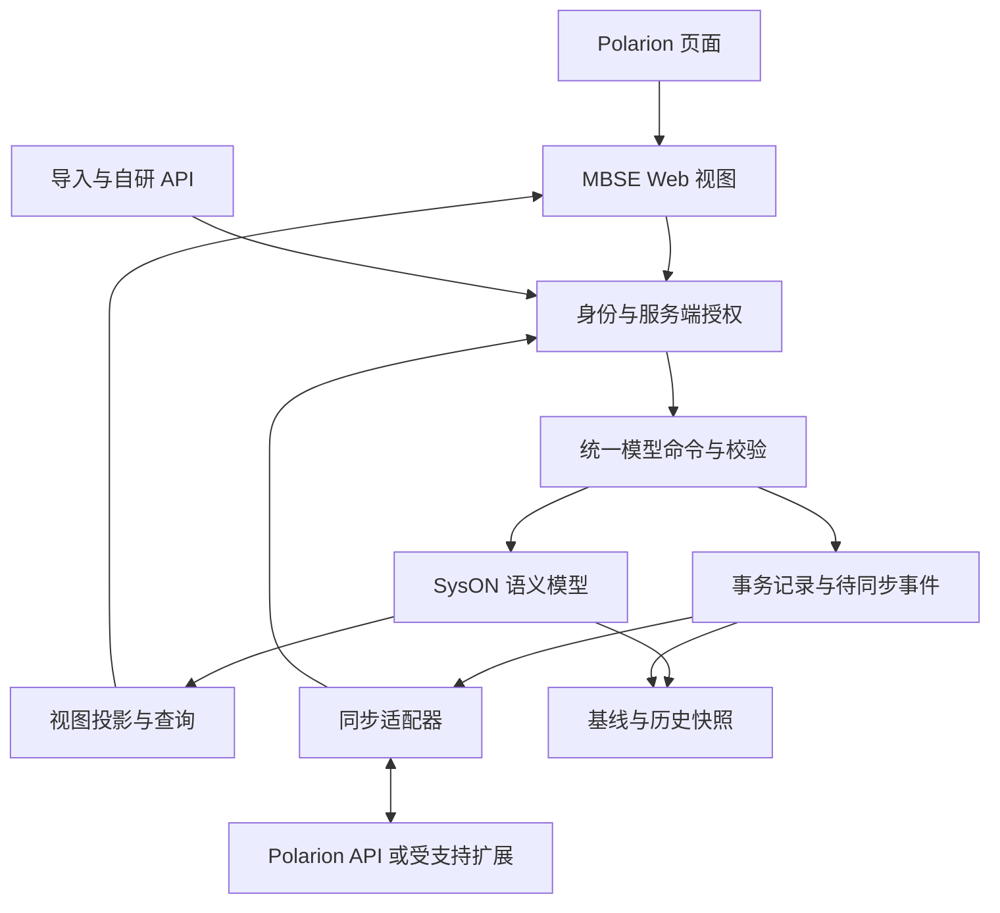

# 自研 MBSE 工具开发方案：SysON 底座 + Papyrus 视图机制 + Capella 分层（适配 Polarion 嵌入）

> **Claude Code 执行版 · v2.0 · 2026-11-10**
>
> 本文既是产品与技术规格，也是编码智能体的执行任务书。默认场景：项目已有实现，先核实、复用和增量改进；仅在仓库确实为空时初始化新项目。
>
> 标题中的“Papyrus 视图机制”指借鉴模型与视图分离、多视图编辑的设计思想；实际 Web 技术采用 **Sirius Web View DSL / View Description**。“Capella 分层”指采用 **Arcadia 方法的工程视角与规则**，不引入第二套 Capella 语义仓库。
>
> 本文不是当前产品已完成清单。所有“必须”“验收”均为本项目要求；上游事实见第 23 节来源。自研接口、DTO、状态和模块名是本方案约定，不是 SysON、Sirius Web 或 Polarion 已提供的原生 API。

## 阅读与执行导航

| 读者/任务 | 重点章节 |
|---|---|
| Claude Code 首次执行 | 0、1、2、18、19 |
| 模型与视图实现 | 3—7 |
| Polarion、权限和同步 | 8—11 |
| 基线、迁移与交付 | 12—17 |
| 验收与恢复工作 | 18—22 |
| 技术事实与版本核对 | 23 |

---

## 0. 给 Claude Code 的执行指令

### 0.1 角色与目标

你是本项目的实现工程师。读取当前仓库及本文后，完成可运行、可验证的增量交付。默认处理用户已有实现，不能因为旧设计术语不准确就推倒重建。

工作方式：

1. 读取适用的仓库说明、CLAUDE.md、AGENTS.md、构建文件、依赖锁文件与现有测试，遵守运行环境和用户授权。
2. 检查工作区状态，保留用户未提交修改，不重置、不覆盖无关文件。已有项目沿用其模块结构、构建工具和编码约定。
3. 执行 WP-00 仓库审计，将每项能力归类为“已验证、待验证、部分实现、模拟实现、缺失、环境阻塞”。旧计划勾选和截图不能代替实现证据。
4. 在审计完成后继续执行依赖满足的工作包，不只输出计划就停止。优先补齐一条真实纵向功能，再扩大视图和方法覆盖。
5. 已正确实现的能力补上必要证据即可关闭；局部问题局部修复。只有证明现有结构无法满足关键不变量时，才提交有迁移与回退设计的替换实现。
6. 独立模块可以并行开发，共享模型契约、数据库迁移、权限入口和最终合并必须协调；不要让多个任务同时修改同一核心模型结构。
7. 无真实 Polarion 连接时，继续完成本地模型功能、适配器契约和故障模拟测试；将真实联调明确标记为 BLOCKED_EXTERNAL。模拟通过不得写成真实集成通过。
8. 如果某个上游能力、类名、配置项或扩展点不确定，先检查锁定版本的源码、文档和测试。不得凭名字编造可调用 API。
9. 每个工作包完成后，记录变更、运行命令、实际结果、证据、已知限制和下一项。遇到上下文限制时写检查点，后续会话从检查点继续。
10. 生产部署、生产数据写入、删除或不可逆迁移按已有授权执行；缺少授权时先完成本地实现、演练与可审阅变更包，再指出具体需要的授权。普通代码修复和隔离测试无需反复确认。

本文要求你实现项目，不要求绕过工具权限、仓库规则或访问控制。

### 0.2 首次执行必须生成的项目记录

以下是建议路径；仓库已有等价位置时复用，记录映射，避免为对齐目录而搬动整个项目。

| 文件 | 必须包含的内容 |
|---|---|
| `docs/mbse/as-is-audit.md` | 当前架构、代码路径、实际功能、遗留问题、现有数据量与环境限制 |
| `docs/mbse/version-matrix.md` | SysON/Sirius Web/Java/Node/数据库/Polarion/领域库版本与来源 |
| `docs/mbse/capability-matrix.md` | 需求 ID、实现状态、实现位置、验证结果、限制 |
| `docs/mbse/execution-status.md` | 工作包状态、依赖、当前任务、下一步、检查点 |
| `docs/mbse/decisions/` | 仅保存影响模型、事务、同步、权限和兼容性的架构决定 |
| `docs/mbse/evidence/` | 脱敏后的测试报告、版本清单、恢复与性能记录 |

不要创建大量空文档充当交付。记录应随着实际工作更新。

### 0.3 一次性启动提示词

将本文件放到项目的 `docs/` 下，然后在项目根目录打开 Claude Code，输入：

```text
请完整读取 docs/MBSE_SysON_Papyrus_Arcadia_Polarion_ClaudeCode_Plan.md，按其中的执行协议实施。

默认这是已有项目：先完成 WP-00 仓库与能力审计，保留现有可用实现，然后按工作包依赖增量修复和补齐。
审计后直接继续执行可以完成的开发、测试和隔离环境验证，不要停留在建议或计划阶段。
所有上游扩展点以当前锁定版本的源码为准，本文接口属于自研契约，不能假设上游已经存在。
没有真实 Polarion 环境时继续完成适配器和模拟验证，将真实联调列为环境阻塞，不得伪造通过结果。
持续更新 docs/mbse/execution-status.md，并在每个工作包结束时报告实际修改、验证证据、限制和下一步。
```

### 0.4 CLAUDE.md 的使用方式

已有 CLAUDE.md 时保留其内容，只补充简短项目入口和关键约束；不要把本长文全文复制进去。Claude Code 官方支持项目指令文件，具体加载行为以安装版本为准。[S16]

建议加入的项目片段：

```markdown
## MBSE 项目

- 开发依据：docs/MBSE_SysON_Papyrus_Arcadia_Polarion_ClaudeCode_Plan.md。
- 开始任务时先读 docs/mbse/execution-status.md 与本次相关章节。
- 默认增量改造，保留现有模型 ID、外部映射和用户未提交修改。
- 单一 SysML v2 语义模型；视图与索引不得成为第二份架构事实。
- 所有模型读写入口执行服务端授权；所有语义写入经过统一一致性规则。
- 模拟 Polarion 通过与真实联调通过分开记录。
- 不将文本导出、项目标签或数据库备份单独宣称为可复现工程基线。
- 工作完成必须提供实际命令、结果与证据；阻塞和未执行项明确标记。
```

## 1. 产品目标与范围

### 1.1 产品定位

建设嵌入 Polarion 的 Web MBSE 工作平台，覆盖系统架构、接口、功能分配、需求追溯、变更影响和受控发布。

核心用户：系统工程师、架构师、接口工程师、需求工程师、评审者和项目管理员。首个交付面向一个企业内若干项目、几十名在线用户；并发与规模必须通过第 17 节规定的负载验证。

“模型为事实来源”的范围是系统结构与建模语义；Polarion 仍是需求正文、审批与工作流的主责系统。两边通过明确身份与修订关联，不争夺同一字段的主责。

### 1.2 交付范围

| 范围级别 | 能力 |
|---|---|
| 核心闭环，必须 | 组件定义与使用、端口与连接、模型树与属性编辑、同模型多视图、需求引用、架构/接口 WI 映射、服务端授权、持久化和基本校验 |
| 工程试用，必须 | OA/SA/LA/PA/EPBS 最小方法支持、类型化跨层关系、分配与追溯矩阵、同步故障恢复、语义差异、不可变基线、历史只读查看、项目包恢复 |
| 产品化，必须 | 迁移演练、审计、运行监测、备份恢复、容量验证、权限回归、上游升级验证、真实 Polarion 联调 |
| 按用户收益扩展 | 更丰富的行为视图、报告模板、产品变体、分支合并、仿真/求解器、Cameo/Papyrus 交换适配 |

首期不承诺全功能替代 Cameo/EA，不默认引入 fUML、复杂 CRDT、任意 XMI 无损互导或完整 Capella Desktop 能力。不存在用户明确要求的 SiP、Xpedition、PLM、车载网络数据库等连接器时，不将它们自动纳入主线。

### 1.3 产品角色

| 本产品角色 | 最小能力 | 约束 |
|---|---|---|
| Reader | 读取获授权模型、视图、追溯和基线 | 导出权限可以单独控制 |
| Modeler | 修改获授权工作模型、创建视图、提交变更 | 不能改发布基线或审批自己的权限 |
| Reviewer | 查看差异、处理评审意见、确认方法例外 | 不自动等同于模型编辑权限 |
| ProjectAdmin | 配置本项目映射、方法规则、授权绑定 | 无权自动扩大到其他项目 |
| IntegrationWorker | 执行范围受限的同步任务 | 记录服务身份与真实发起者，不能绕过字段主责 |

这些角色是应用能力分组，不能假定与某一 Polarion 角色名称直接等价。实际角色映射在部署配置中完成。

### 1.4 需求标识

| ID | 需求 |
|---|---|
| FR-01 | 一个 SysML v2 语义仓库支持定义、使用、端口、连接及需求相关语义 |
| FR-02 | Arcadia 五个工程视角及有类型的跨层关系 |
| FR-03 | 人工选择视图与自动范围视图，模型修改后显示一致 |
| FR-04 | 图形、API、导入和同步共用模型授权及校验 |
| FR-05 | Polarion 需求引用、架构 WI 和接口 WI 的受控集成 |
| FR-06 | 同步幂等、冲突处理、未知结果恢复、对账与审计 |
| FR-07 | 追溯矩阵、覆盖检查及可解释变更影响 |
| FR-08 | 不可变基线、语义差异、历史查看和恢复 |
| FR-09 | Polarion 嵌入、项目上下文、登录与授权联动 |
| FR-10 | 项目包与声明范围的标准文本交换 |
| FR-11 | 权限、备份、迁移、升级与容量验证 |

## 2. 事实基线与版本策略

### 2.1 必须纠正的技术前提

1. SysON 采用 SysML v2/KerML 和 Sirius Web；其 2026.11.0 文档没有把版本管理、分支、访问控制作为内置交付能力。本文单独建设或接入这些能力。[S01][S02]
2. Sirius Desktop 的 `.odesign` 不能直接当成当前 Sirius Web 的配置格式；采用 View DSL/View Description。SysON 已使用程序化视图构造，Java builder 并不等于放弃声明式视图。[S03][S04]
3. General View 的 unsynchronized 指元素入图的选择策略，不表示已显示对象不随语义模型更新。[S05]
4. SysML v2 的领域扩展以库、特化和 metadata 为基础；不采用 UML Profile 的 stereotype 机制解释 v2 内核。[S06]
5. Arcadia 是工程方法，不等于五个包和一串无类型 allocate。Capella for SysON 可作为方法库与视图扩展的参考，复用前必须验证依赖和覆盖范围。[S07][S08]
6. Polarion 2606 REST 文档列出了基线等未覆盖领域；SSO、条件更新和外部修订能力都必须按实际部署版本验证。[S10][S11][S12]

### 2.2 已有仓库

先保留当前能够构建与运行的版本组合。记录：源码提交、SysON/Sirius Web 版本、父 POM/BOM、Java、Node、包管理器、React/TypeScript、数据库和库文件哈希。不得为追逐最新版而同时升级全部依赖。

检查上游差异，按“扩展模块、必要补丁、直接修改核心、无法解释的复制代码”分类。优先把业务定制放到受支持的扩展点；确需核心补丁时，附上原因与升级回归场景。

### 2.3 空仓库

本方案编写时官方发布页已列出 SysON `v2026.11.0`，可作为新项目候选基线。[S01] 使用该发布对应的 Sirius Web 依赖和构建要求，不独立挑选“最新 Sirius Web”。

如果所需 Arcadia 扩展只兼容其他版本，先做兼容性验证并形成决定记录，再选择组合。不要把 README 的版本样例当成当前可用组合。

Java/Node/数据库的具体版本以选定发布的构建文件、锁文件和部署说明为准，由 WP-00 填入版本矩阵。禁止在未核查前假定任意 LTS 都兼容。

### 2.4 版本清单至少包含

| 项目 | 必填内容 |
|---|---|
| 上游 | 仓库、tag、完整 commit、依赖管理来源 |
| 本产品 | 版本、commit、工作区是否有未提交修改 |
| 语言/领域库 | SysML/KerML 库、Arcadia 库、自研扩展的版本及哈希 |
| 运行环境 | Java/Node/数据库/浏览器/构建工具版本 |
| Polarion | 实际产品版本、API 版本、SDK/OSLC 使用情况、能力探测结果 |
| 数据 | 模型 schema、治理 schema、视图描述及迁移版本 |

未知值应写为 UNVERIFIED 并绑定验证任务，不能填一个猜测值后宣称已锁定。

## 3. 目标架构与扩展边界

### 3.1 模块化单体为默认部署

优先在现有 SysON 应用中增加清晰模块和后台任务。除非现有系统已有合理服务边界，不为了“企业架构”拆出大量微服务。



图中的调用路径表示职责。具体事务和进程边界按锁定版本实现；不能据此假设 SysON 已有同名接口。

### 3.2 建议逻辑模块

| 模块 | 职责 | 不能承担的职责 |
|---|---|---|
| `model-adapter` | 包装上游语义对象、命令、序列化和引用解析 | 不另建 Block/Port 主数据库取代 SysON |
| `method-library` | 领域库、metadata、工程关系与方法规则 | 不复制一份 Capella Ecore 作为并行事实源 |
| `view-extension` | View Description、交互工具、投影、布局 | 不在图节点 JSON 中隐藏业务关系 |
| `validation` | 结构不变量、方法成熟度、诊断与例外 | 不把所有未完成设计都当不可保存错误 |
| `security` | 身份映射、授权、项目边界、审计上下文 | 不只通过前端按钮实现权限 |
| `polarion-adapter` | 能力探测、字段策略、WI 读写、转换 | 不绕过模型命令直接修改语义存储 |
| `integration-journal` | 映射、outbox/inbox、冲突、重试、对账 | 不声称跨系统拥有一个本地数据库事务 |
| `configuration` | 模型修订、快照、基线、差异、恢复 | 不将锁或项目复制等同于分支合并 |
| `web-shell` | 嵌入上下文、导航、属性面板、状态展示 | 不成为权限或字段主责的最终裁决点 |

模块名为建议，不要求建立同名 Maven module 或 npm package。先复用仓库现有结构，只有独立编译/复用确有收益时才拆包。

### 3.3 持久化与事务

模型语义使用选定 SysON 的持久化机制。SQL 治理表用于版本头、映射、同步、审计、快照清单及可重建索引。不得同时维护一套独立“组件表/连接表”作为另一可编辑事实源。

一次语义命令必须满足：授权检查、期望版本检查、变更、必要一致性校验、持久化、应用修订号更新及待同步记录之间的原子性要求。

推荐先验证能否在同一持久化事务中保存语义变化与 outbox。若上游事务模型无法直接支持，必须设计可恢复的持久化命令日志/提交协议并做崩溃测试；不能用“先保存模型，再尽力发消息”代替。

只有持久化提交成功后才发布成功通知和外部同步任务。失败时清理或重建编辑上下文中的未提交变更，避免内存显示与数据库不一致。

### 3.4 多实例编辑

同一模型的权威编辑上下文只能有明确的写入所有者。先查明上游的编辑上下文生命周期和请求串行化方式。

默认先用单个模型写入所有者、应用级修订校验与短事务保证一致性。多应用副本时，必须验证路由、共享状态和失效处理；不能让两个副本各持一份可写 EMF 对象图，再用最后一次数据库保存覆盖前者。

若采用分布式租约，必须具备到期处理和 fencing token 等防止旧持有者继续提交的机制。项目/元素编辑锁是协作策略，不是版本、事务和授权的替代品。

## 4. 语义模型与身份契约

### 4.1 单一语言内核

业务模型使用 SysML v2/KerML。领域扩展优先使用版本化领域库、特化及 MetadataDefinition/MetadataUsage；不修改核心语言元模型来增加 `LogicalBlock`、`PhysicalBlock` 等私有核心类型。

方法服务可采用独立平台对象保存流程状态、映射或评审意见，但这些对象必须有清晰的标准语义引用与交换边界。已有自定义 EClass 不立即删除，先识别数据、制定映射并迁移。

| 用户概念 | 优先核查的 v2 表达 | 注意事项 |
|---|---|---|
| 组件类型 | PartDefinition | 定义可以被多个工程上下文复用 |
| 部件使用 | PartUsage | Usage 不能简单等同于一台运行时物理实例 |
| 端口契约与使用 | PortDefinition、PortUsage | 保留方向、类型、继承和共轭语义 |
| 接口、连接 | Interface/Connection 的定义或使用 | 端点必须带使用上下文 |
| 信息/物质/能量传递 | 相应 Item/Flow 等 v2 语义 | 不把一根图形线自动解释为任意流 |
| 功能 | ActionDefinition/ActionUsage 等适用语义 | 功能分解、执行分配和控制流分开 |
| 需求 | RequirementDefinition/RequirementUsage 等 | 外部需求镜像与完整形式化需求分开标识 |
| 满足与验证 | 锁定版本支持的 v2 满足/验证语义 | 通用 trace 不自动升级为 satisfy/verify |
| 方法标签 | 领域库与 metadata | 界面可使用熟悉的名称，不改变真实类型 |

本表不是逐项转换标准。精确映射必须在 `semantic-mapping.md` 记录实际类型、约束、序列化及导入导出表现。[S06]

### 4.2 稳定元素身份

应用引用至少可区分以下范围：`repositoryId`、`projectId`、`modelId`、稳定 `elementId`。上游已有等价身份时复用并建立映射，不额外生成一套无意义的并行 ID。

要求：

- 名称和显示路径可以修改，不作为身份主键。
- 在同一模型修订链中，改名、移动、改样式不改变元素身份。
- 删除后重建同名元素默认是新身份，不偷偷继承旧 WI 映射。
- 外部 WI 身份包括 Polarion 实例、项目和 WI ID，单独的 `WI-123` 不能全局唯一。
- 只读历史查看使用基线/修订上下文解析身份，不写回当前模型。
- 可编辑复制默认创建新模型范围并重建外部映射；不能无提示地让两个可编辑副本写同一个 WI。
- 标准文本导入若不能保留源 ID，必须产生显式身份映射或按新模型导入，不按名称自动合并。

### 4.3 上下文端点引用

端口可能来自组件定义或继承，不要求为了区分上下文而复制每一个 PortUsage。端点身份必须结合结构作用域、部件使用路径和端口特征路径解析。

以下是本应用 DTO 示例，不是上游 API：

```json
{
  "schema": "mbse.endpoint-ref/v1",
  "repositoryId": "repository-demo",
  "scope": {
    "modelId": "model-temperature-control",
    "elementId": "system-usage"
  },
  "partUsagePath": [
    {
      "modelId": "model-temperature-control",
      "elementId": "controller-a-usage"
    }
  ],
  "portFeaturePath": [
    {
      "modelId": "controller-library",
      "elementId": "controller-temperature-port"
    }
  ],
  "definitionRef": {
    "modelId": "controller-library",
    "elementId": "controller-definition"
  },
  "resolutionMode": "INHERITED_FEATURE"
}
```

同一 Controller 定义被 `controller-a-usage` 和 `controller-b-usage` 使用时，即使端口特征 ID 相同，两个路径仍解析到不同的上下文端点。`definitionRef` 只帮助解释类型，不能代替端点身份。

每个路径引用按实际身份范围携带 repository/project/model/resource 信息；已有全局唯一标识可采用等价表示。本例引用位于同一仓库，跨仓库引用需在对应路径项标明范围。解析必须使用工作模型或指定基线绑定的依赖版本，不能总是读取共享库 HEAD。

校验器必须检查路径中每一步的所有权、继承、重定义和可达性。对超出声明支持范围的多重性选择、动态索引或复杂特征链返回明确诊断，不能默认取第一个对象。

### 4.4 方法上下文与复用

每个工程上下文有明确的 perspective、方法库版本与根范围。OA/SA/LA/PA/EPBS 是工程视角，不能因为共享定义被两处引用就反复修改定义上的单一 layer 字段。

方法上下文附着于语义工程包、相关 Usage 或独立且版本化的工程上下文对象；类型库保持可复用。视图根引用该上下文并选择展示范围，不能仅通过视图配置改变对象层次。明确显式声明、所属上下文继承及允许覆盖的优先级；冲突返回诊断，不按颜色、名称或当前页面推断层次。

### 4.5 必须始终成立的不变量

| ID | 不变量 |
|---|---|
| INV-01 | 一个业务语义事实只有一个权威模型表示；视图与索引只是引用或投影 |
| INV-02 | 外部可访问的模型查询、变更、订阅和导出执行服务端授权 |
| INV-03 | 所有语义写入更新受控修订并经过同一组必要一致性检查 |
| INV-04 | 连接端点在其结构作用域内可解析，不能只依赖名称或定义 ID |
| INV-05 | 语义删除、视图移除、外部资源不可见是不同操作/状态 |
| INV-06 | 已发布基线不可被后续工作模型编辑改变 |
| INV-07 | 同步任务失败、重复、乱序或重启不能静默丢失已提交变更 |
| INV-08 | 来源不明、版本未知或语义不支持时显式说明，不能生成虚假成功 |

## 5. Arcadia 方法最小实现

### 5.1 五个工程视角

| 视角 | 首期对象和问题 | 交付判据 |
|---|---|---|
| OA | 运行参与方、运行活动、场景、交换；谁要完成什么任务 | 能表达外部运行需求及活动联系，不混入全部技术实现 |
| SA | 系统边界、系统功能、外部接口、需求引用 | 系统职责清楚，功能可分解并关联运行目标 |
| LA | 逻辑组件、功能执行分配、逻辑接口与功能链 | 功能由谁承担可追溯，同时记录性能、安全等约束 |
| PA | 具体硬件/软件实现、部署或承担关系、技术接口 | 技术选择及其实现关系明确，不把 PA 简化成硬件树 |
| EPBS | 配置项、交付分解、要求和验证责任 | 配置项能追溯到实现对象及交付/验证责任 |

遵循迭代工程方式，允许从已有物理架构补建逻辑说明，允许带来源的跨层追溯。逻辑架构暂缓具体实现选择，但仍需考虑非功能约束；EPBS 不能仅作为 BOM 导出目录。[S07]

### 5.2 工程关系分类

下列 relationKind 是本项目契约，不是 SysML 保留字、上游 Java 类或官方一对一映射。实现时将它们映射到锁定领域库中的标准关系、特化关系或带清晰 metadata 的语义对象。

| relationKind | 源 → 目标 | 工程含义 | 默认约束 |
|---|---|---|---|
| `OPERATIONAL_REALIZATION` | OA 活动/能力 → SA 功能/能力 | 系统如何支持运行目标 | 允许多对多，必须保留实现依据 |
| `FUNCTION_REALIZATION` | SA 功能使用 → LA 功能使用；按方法配置支持 LA → PA 功能使用 | 不同视角的功能职责如何实现或细化 | 允许多对多；与功能分解、组件承担分开 |
| `FUNCTION_ALLOCATION` | 功能使用 → 同一工程上下文中的组件使用 | 哪个组件承担功能 | 明确视角与类型；跨视角分配必须在许可矩阵中另行声明；基数按项目规则 |
| `ARCHITECTURE_REALIZATION` | LA 组件 → PA 对应架构对象 | 逻辑架构如何具体实现 | 允许拆分、合并及带理由的多对多；功能实现归入 FUNCTION_REALIZATION |
| `CONFIGURATION_MEMBERSHIP` | PA 实现对象 → EPBS 配置项 | 配置和交付归属 | 主归属与共享引用区分，禁止归属循环 |
| `REQUIREMENT_TRACE` | 需求引用 → 功能/组件/接口/验证对象 | 一般相关性追溯 | 不自动代表满足或验证通过 |
| `SATISFACTION_ASSERTION` | 设计主体 → 需求 | 明确的满足声明 | 需映射到受支持的满足语义及适用范围 |
| `VERIFICATION_REFERENCE` | 验证对象/用例 → 需求 | 计划或实施验证的关联 | 验证关系与执行结果分开 |

源目标方向是应用中统一约定，不强行等同于上游序列化方向；适配器必须记录映射。

每条关系保存稳定身份、关系种类、端点、工程上下文、来源、创建/修改修订。复核状态、理由和外部证据可放治理存储，但须与关系修订绑定。

以关系许可矩阵替代“禁止所有跨层分配”。未配置关系创建默认给出不支持说明，不退化成无类型字符串边。

### 5.3 跨层初始化与增量变更

跨层初始化不是简单复制全部对象。实现步骤：

1. 根据选定规则形成变更预览，列出创建、复用、更新、冲突及不支持项。
2. 记录源模型/元素/修订、目标上下文、转换规则版本、目标元素和初始化操作 ID。
3. 相同输入与操作重放不得重复生成对象。
4. 再次执行时保留人工修改，只对规则明确管理的字段提出更新；有分歧转为待复核。
5. 源对象删除默认产生影响项，不自动级联删除已人工设计的下层架构。
6. 应用变更前按期望模型修订重检，避免预览后其他用户修改被覆盖。

跨层初始化维护稳定生成映射：建议唯一键为“源元素稳定引用 + 目标工程上下文 + generationSlotKey”。generationSlotKey 表示一对多转换中的稳定输出角色，不能用运行时间或随机操作 ID。源修订和规则版本属于映射版本信息，不直接决定是否新建对象。再次执行先查既有映射；输出结构变化时迁移映射并保留人工设计。operationId 负责同一次命令重放，生成映射负责不同执行之间的增量识别。

### 5.4 方法库选择

优先审查 Capella for SysON 与 Arcadia SysML v2 库是否覆盖当前需求。[S08][S09] 复用时锁定 commit、库依赖与命名空间。上游仍在演进的内容不能直接视为稳定规范。

已有自研库正确且可迁移时继续使用；为兼容上游引入适配层或版本迁移，不同时维护两份含义相同的可编辑关系。

### 5.5 交换与功能链

运行/功能交换至少记录发送方、接收方的上下文引用、载荷或交换项、方向、工程视角和适用场景。功能链保存稳定身份、成员功能使用、交换引用、所选路径/分支、边界和场景上下文，不以画布连线顺序代替语义。

具体类型映射使用已选领域库并登记在语义映射表。首期功能链用于连通性检查、结构追溯与影响分析；未实现的执行行为列为部分支持，不宣称具有仿真能力。删除或改变交换端点时，对依赖链产生可定位诊断；重复显示同一交换不创建另一业务交换。

## 6. 视图体系与交互规格

### 6.1 实现机制

复用当前 SysON/Sirius Web 的 View Description、builder、Java services 和前端扩展点。先寻找一个现有结构视图作为样例，完成最小扩展并构建运行；不要从 Desktop `.odesign` 文件推测 Web API。[S03][S04]

视图描述可以由代码生成，也可以在选定版本支持的建模工具中定义。采用哪种方式由可测试性、版本控制和已有项目实践决定，不要求所有功能都变成无代码配置。

### 6.2 首期视图清单

| ID | 视图 | 默认成员策略 | 主要能力 |
|---|---|---|---|
| V-01 | 结构定义视图，可显示 BDD 风格简称 | CURATED | 类型、特化、包含、被使用位置查询 |
| V-02 | 结构互连视图，可显示 IBD 风格简称 | QUERY_DRIVEN 或 CURATED | 部件使用、上下文端口、接口、连接、有效性 |
| V-03 | OA 场景/活动视图 | CURATED | 参与方、活动、运行交换与相关需求 |
| V-04 | SA 功能/功能链视图 | QUERY_DRIVEN 或 CURATED | 系统功能、分解、交换与边界 |
| V-05 | LA 架构视图 | QUERY_DRIVEN | 逻辑组件、功能承担关系及接口 |
| V-06 | PA 架构视图 | QUERY_DRIVEN | 实现组件、技术接口及 LA 实现追溯 |
| V-07 | EPBS 配置树/表 | QUERY_DRIVEN | 配置项、交付责任及实现范围 |
| V-08 | 分配与追溯矩阵 | QUERY_DRIVEN | 关系筛选、缺口、待复核和版本 |
| V-09 | 变更影响视图 | QUERY_DRIVEN | 传播路径、影响理由、确认与排除 |

这些名称是产品视图名称，不宣称与 SysML v1 图种一一对应。v2 标准视图与 v1 图种存在差异。[S14]

### 6.3 成员策略

`CURATED`：使用者明确选择展示对象，可加入已有语义元素、移除展示、隐藏或折叠。不能把“加入已有对象”实现为复制语义对象。

`QUERY_DRIVEN`：根据根对象、工程视角、关系类型、深度和过滤条件计算成员。必须设置可见对象上限和跨资源范围，超过阈值时提示缩小范围或分层展开，不默认遍历全模型。

两类视图都随已提交语义变化刷新显示。用户主动选择的成员信息应与上游 ViewUsage/expose 等实际机制保持一致，不另建一份互相竞争的成员真相。

### 6.4 视图状态

允许保存：表示 ID、视图定义及版本、根引用、成员选择/查询、位置、尺寸、固定、折叠、隐藏、过滤和明确的视图标注。

不能仅在画布状态中保存：端口类型、连接端点、组件归属、功能分配、需求满足等业务事实。

布局键应包含表示 ID、节点描述和语义上下文引用，不能只用对象名称。语义变化后保留已有人工布局，新对象采用局部布局策略；全图重新布局必须是明确操作。

### 6.5 图形命令

| 操作 | 必须发生的结果 |
|---|---|
| 创建组件使用 | 经统一命令创建真实语义对象，再更新显示 |
| 加入已有对象 | 只修改视图展示成员 |
| 从图移除/隐藏 | 不删除模型和其他视图中的对象 |
| 删除模型对象 | 检查授权、影响和引用策略，经事务删除或归档 |
| 创建连接 | 解析上下文端点并校验，然后创建语义连接 |
| 修改属性 | 只修改允许编辑的语义/治理字段，保持字段主责 |
| 自动布局 | 只修改视图状态，不改变模型关系 |

语义删除与视图移除必须是不同后端命令，不能仅通过按钮文字区分。

### 6.6 最小界面

采用已有 SysON 页面结构：模型树、画布/表格、属性面板。新增工程视角导航、验证问题列表、Polarion 关联面板、同步状态、变更影响与基线选择。

问题列表支持按规则、严重度、视角和状态筛选，并定位到相关元素。同步状态应显示未完成或冲突原因及允许的处理动作，不只显示红点。详情、错误和提示采用业务语言，不暴露内部类名和令牌。

## 7. 校验与方法成熟度

### 7.1 共享校验入口

画布、属性面板、自研 API、导入、批量任务和 Polarion 入站都调用统一语义规则。查明原生 GraphQL/REST/编辑工具写入路径，确保没有只保护新接口而遗漏上游入口的情况。

规则分三类：

- `COMMIT_INVARIANT`：必要结构或身份约束，失败拒绝/回滚正常提交。
- `DRAFT_DIAGNOSTIC`：草稿可保存的问题，例如未完成分配；持续可见。
- `RELEASE_GATE`：建立合格发布基线前必须满足或有适用例外。

历史模型有问题时允许受控只读诊断。增量修改检查影响范围，避免每次保存都全量扫描；规则版本升级、导入及发布时执行相应全量验证。

### 7.2 最小规则目录

| 规则 ID | 检查 | 默认执行阶段 |
|---|---|---|
| SEM-001 | 稳定身份唯一、必要引用可解析 | 提交 |
| SEM-002 | 定义/使用、所有权及类型符合内核约束 | 提交 |
| SEM-003 | 所有权无非法循环、跨资源引用受控 | 提交/导入 |
| IF-001 | 连接端点在指定上下文可解析 | 提交 |
| IF-002 | 方向、共轭和连接方式符合支持的语义 | 提交，未知情况给明确诊断 |
| IF-003 | 载荷类型、单位、多重性及兼容策略 | 提交或发布，按项目规则 |
| ARC-001 | 方法关系类型、端点和视角满足许可矩阵 | 提交 |
| ARC-002 | 关键功能完成执行分配 | 草稿告警/发布门槛 |
| ARC-003 | 关键 LA 对象具有 PA 实现依据 | 草稿告警/发布门槛 |
| ARC-004 | 配置归属和交付/验证责任完整 | 发布门槛 |
| REQ-001 | 外部需求引用、来源和修订可识别 | 同步/发布 |
| REQ-002 | 已变化需求的相关设计处于适当复核状态 | 变更/发布 |
| MAP-001 | 映射身份、主责和生命周期责任不冲突 | 同步/发布 |
| LIB-001 | 领域库、映射规约和规则版本可解析 | 启动/导入/发布 |
| CFG-001 | 发布清单引用闭包完整且无未决关键同步 | 发布门槛 |

接口兼容判断不能只比较端口名称。类型、单位与方向的详细语义优先复用语言内核和标准库；对不支持的组合返回 UNKNOWN/UNSUPPORTED，不默认为兼容。

### 7.3 诊断契约

结果至少包括：规则 ID/版本、严重度、执行阶段、元素与关系引用、上下文路径、说明、建议操作、模型修订、触发入口。读取诊断也执行授权，不能通过错误信息泄露其他项目的对象名称。

例外需有适用范围、理由、责任人、有效修订及到期/重评条件。规则例外只用于明确允许的工程规则，不能豁免越权、身份冲突或数据损坏。

### 7.4 表达式边界

AQL/视图查询、OCL/模型约束、SysML v2 约束与执行语义分别登记支持范围。Eclipse OCL 可用于 Ecore 等上下文的校验，但不等于自动支持所有 v2 工程约束。[S15]

优先复用现有验证框架和 Java 服务。若引入 OCL，锁定上下文类型、版本和执行时机；不支持的表达式明确报错。不要把“实现 OCL 子集解释器”作为没有实际需求支撑的前置项目。

## 8. 自研服务契约与治理数据

### 8.1 与原生接口的关系

优先扩展或包装已存在的 SysON 服务。保留上游 GraphQL 供既有 UI 使用时，必须接入同样的授权、修订和校验机制。不得创建一套安全的新 API，却让旧 mutation 仍可绕过。

以下 `/mbse/api/v1` 路径是本产品拟定的自研接口。已有等价接口可保持原路径并在文档中建立映射；不能将这些路径标成 SysON/Polarion 原生接口。

| 方法与路径 | 职责 | 主要要求 |
|---|---|---|
| GET `/projects/{projectId}/capabilities` | 返回当前用户可用能力 | 不暴露其他项目权限信息 |
| GET `/models/{modelId}/elements` | 按范围查询语义投影 | 分页、范围限制、模型修订 |
| POST `/models/{modelId}/commands` | 受控语义修改 | 期望修订、幂等身份、授权、校验 |
| POST `/models/{modelId}/validate` | 执行指定规则集 | 结果绑定模型与规则版本 |
| GET `/models/{modelId}/traceability` | 追溯与影响查询 | 关系类型、方向、深度、修订明确 |
| GET `/projects/{projectId}/sync-status` | 查看同步与映射状态 | 分页、授权、可操作原因 |
| POST `/conflicts/{conflictId}/resolutions` | 提交冲突处理决定 | 当前版本检查、三方值、审计 |
| POST `/models/{modelId}/baseline-candidates` | 启动捕获与验证 | 异步任务；无完成假象 |
| POST `/baselines/{baselineId}/publish` | 发布已验证候选 | 对精确候选摘要授权和确认 |
| GET `/baselines/{baselineId}` | 查询不可变基线清单 | 当前访问权限生效 |
| POST `/models/{modelId}/exports` | 创建交换/项目包任务 | 声明格式、范围、支持等级 |
| POST `/projects/{projectId}/imports` | 导入到受控暂存区 | 冲突策略、校验、禁止默认外发 |
| GET `/jobs/{jobId}` | 查询导入、导出、基线任务 | 任务与项目授权 |

不要求为上游已提供的可靠功能重复开发 REST 封装；要求上述业务能力拥有明确且可测试的契约。

### 8.2 命令示例

```json
{
  "commandId": "67f33b1d-4f98-4a35-bf17-d93a355b4a24",
  "expectedModelRevision": "local-r000042",
  "commandType": "CREATE_PART_USAGE",
  "payload": {
    "ownerId": "system-usage",
    "definitionRef": {
      "modelId": "shared-library",
      "elementId": "controller-definition"
    },
    "name": "controllerA",
    "engineeringContextId": "pa-main"
  }
}
```

这是应用命令示例。实现方负责将其转换为已核实的上游编辑命令，不从 JSON 直接拼写任意 EClass 或反射调用。

```json
{
  "commandId": "67f33b1d-4f98-4a35-bf17-d93a355b4a24",
  "status": "COMMITTED",
  "modelRevision": "local-r000043",
  "createdElementIds": ["controller-a-usage"],
  "diagnostics": [],
  "externalSync": "PENDING"
}
```

响应明确区分模型已提交与外部已同步。应用修订号是本产品受控版本，不假称为上游标准 API 已完整提供的 commit 历史。

相同操作者、项目和 commandId 的相同请求返回原结果，不再次执行；相同幂等键携带不同请求摘要应拒绝。命令状态与返回结果持久化，服务重启后规则仍成立。

返回历史回执前仍须按当前权限授权。请求摘要覆盖命令类型、目标项目/模型、路径业务身份和请求内容，不能只 hash JSON body；更换目标模型不能命中另一模型的结果。撤权后重放旧命令不能读取原回执中的受保护数据。

### 8.3 失败语义

自研接口使用明确错误码：未认证、未授权、版本冲突、语义无效、外部结果未知、依赖不可用、不支持能力。可采用 HTTP 401/403/409/422/503 等匹配状态；具体约定在 OpenAPI 中固定。

对未授权资源是否使用 404 隐藏存在性应保持统一。错误响应包含 correlationId、稳定错误码和可操作说明，不回显令牌或整个内部模型。

### 8.4 治理数据逻辑表

以下为逻辑存储要求。已有同等表或可靠服务优先复用，SQL DDL 由实现者根据数据库与迁移工具生成。

| 数据集 | 核心字段 | 索引/约束 |
|---|---|---|
| `model_revision_head` | 模型范围、当前修订、schema、写入所有者/代次 | 模型范围唯一；条件更新 |
| `command_receipt` | commandId、操作者、范围、请求摘要、状态、结果修订 | 幂等范围唯一；结果不可伪造重写 |
| `element_external_mapping` | 双边身份、mappingKind、lifecycleRole、上下文、共同基准、状态 | 按映射种类约束；允许多处引用同一需求 |
| `sync_outbox` | operationId、aggregateKey、序号、模型修订、事件、状态、租约、重试时间 | 操作唯一；状态/重试时间索引；同聚合顺序 |
| `sync_inbox` | 来源实例、事件/修订身份、观察身份、处理结果 | 按可靠来源身份去重；不得全局只按内容 hash |
| `sync_checkpoint` | 来源、分区/查询、已确认水位、对账记录 | 对应来源/分区唯一 |
| `sync_conflict` | 共同基准、双方值/修订、字段、原因、处理操作 | 状态与项目索引 |
| `baseline_manifest` | 候选/发布状态、模型修订、外部版本向量、依赖、摘要 | 发布后内容不可变 |
| `snapshot_object` | 内容摘要、对象位置、大小、类型、schema | 摘要校验；访问控制及保留策略 |
| `audit_event` | 人/服务身份、范围、操作、前后修订、结果、关联 ID | 追加记录；受控读取 |
| `migration_checkpoint` | 迁移版本、源/目标摘要、进度、身份映射、异常 | 可重入，禁止无依据重放 |
| `review_decision` | 变更/关系、目标修订、决定、理由、操作者 | 决定与精确版本绑定 |

含有模型字段的检索索引应注明可重建来源和刷新水位，不能允许独立编辑后与语义仓库双向猜测同步。

## 9. Polarion 适配契约

### 9.1 能力探测是第一项集成工作

针对实际环境生成 `polarion-capabilities.md` 或等价机器可读配置，逐项记录 SUPPORTED_VERIFIED、UNSUPPORTED、UNVERIFIED。

| 能力 | 必须核查 | 不支持或未确认时 |
|---|---|---|
| 认证 | 部署版启用的 PAT/JWT/SSO/服务端会话 | 不降级为匿名或前端存储高权限 PAT |
| WI 读写 | 所需类型、字段、角色、工作流和链接 | 显式限制能力，不强行修改项目流程 |
| 条件更新 | 具体更新端点是否原子检查旧版本 | 收紧写入主责，使用验证过的服务端事务方案或阻塞冲突写入 |
| 创建去重 | 原生幂等、可靠服务端扩展、可检索关联字段 | 未知创建结果进入核对，禁止盲目 POST |
| 变化发现 | 查询、分页、排序、时间过滤或已验证事件扩展 | 采用可恢复轮询与周期对账 |
| 历史读取 | 按已知修订读取；HEAD 修订解析分别验证 | 不将 HEAD 链接当历史引用 |
| 基线 | 实际 SDK/OSLC/流程/修订清单能力 | 限定为项目自有快照，不宣称原生基线集成 |
| 权限 | 端点权限、项目/对象权限及可读取的权限来源 | 无法确认时拒绝受保护访问 |

不假定通用 webhook、If-Match、POST 幂等键、REST 基线或某个 OSLC 服务必然存在。Polarion 官方认证、授权和限制说明是基线资料，仍须核对部署版。[S10][S11][S12]

### 9.2 默认字段主责

| 数据 | 主责 | 另一侧 |
|---|---|---|
| 需求正文、审批、生命周期状态 | Polarion | 模型保存引用/受控镜像，标明源版本 |
| 组件定义/使用、端口和拓扑 | MBSE | WI 展示架构或接口投影 |
| 架构 WI 的负责人、评审工作流 | Polarion | 模型读取并展示 |
| 功能分配和方法实现关系 | 默认 MBSE，按类型配置 | Polarion 展示关联与审查入口 |
| 测试用例和执行结果 | 默认 Polarion | 模型保存关联及指定结果引用 |
| 图形布局和过滤 | 视图存储 | 不反写为需求或接口事实 |
| 身份映射与同步状态 | 集成服务 | 两边展示一致身份和可解释状态 |

修改非主责字段时，生成变更建议或冲突，不静默覆盖。已有字段主责不同则先记录，迁移时逐字段调整，不直接全量回灌。

### 9.3 映射种类和生命周期

| mappingKind | 默认对象 | 外部生命周期策略 |
|---|---|---|
| `REQUIREMENT_REFERENCE` | 模型中的外部需求引用 → 需求 WI | REFERENCE_ONLY；允许多处引用一个需求 |
| `ARCHITECTURE_USAGE_PROJECTION` | 选定范围的部件使用 → 架构 WI | 可创建/更新指定字段；默认不自动删除 |
| `ARCHITECTURE_DEFINITION_PROJECTION` | 明确选中的可复用定义 → 类型 WI | 可选；不与使用位置映射混淆 |
| `INTERFACE_CONTRACT_PROJECTION` | 接口契约 → 接口 WI | 管理契约字段，与连接实例分开 |
| `CONNECTION_PROJECTION` | 上下文连接 → 连接/接口实例 WI | 管理端点引用；端口声明不是唯一身份 |

首期默认同步用户选定的组件使用和连接，不为每个临时对象、端口、库元素自动建 WI。范围用项目配置控制。

每条映射包含：mappingId、两边完整身份、elementKind、上下文引用、mappingKind、lifecycleRole、最近同步模型修订、远端修订/指纹、共同基准、同步与可见性状态。

创建所有权与引用必须分开。可对“一个源对象向一个目标项目的指定投影”设置唯一约束，但不能禁止多个模型位置引用同一需求 WI。

### 9.4 项目字段配置

WI 类型 ID、链接角色、枚举和自定义字段以实际项目配置为准。配置文件保存逻辑字段到实际字段的映射，并在启动/项目接入时验证可读写能力。

示例逻辑字段：外部元素稳定键、映射种类、源模型链接、源修订、接口源端点、目标端点、契约摘要。其具体 Polarion 字段名由部署配置提供，不在程序中写死。

如果需要新增字段，提供可审核的配置变更和迁移步骤；不能假定已有 `modelId`、`sourcePort` 等字段。必要字段缺失时应显式禁用对应写入能力。

### 9.5 需求正文与指纹

保留原始内容及其来源。用于比较的规范化策略必须版本化，并保留表格、列表、链接、单位等有意义结构。字节 hash 用于验证快照完整性；规范化 hash 用于业务比较，两者用途不同。

不能因为富文本清洗后字符串相同就认定所有内容相同。嵌入图片和附件的引用及必要内容也要纳入声明的冻结范围。

## 10. 同步、并发与故障恢复

### 10.1 事件字段

外发事件至少记录：operationId、投递 ID、源系统、真实操作者、模型范围与修订、聚合键和序号、映射种类、字段集合、目标身份、请求摘要、发生时间、状态、重试次数和关联链。

同一业务操作重试复用 operationId；新的业务修改使用新 ID。时间戳用于审计，不能代替可靠版本或默认作为“最后写入获胜”的依据。

### 10.2 外发状态机

| 状态 | 触发 | 下一状态与动作 |
|---|---|---|
| PENDING | worker 获得受控领取权 | IN_FLIGHT，记录租约和操作 ID |
| IN_FLIGHT | 明确成功 | ACKED，持久化映射与确认水位 |
| IN_FLIGHT | 明确无副作用的暂时失败 | RETRY_WAIT，有界退避 |
| IN_FLIGHT | 请求可能执行但没有可靠结果 | UNKNOWN_RESULT，进入核对 |
| IN_FLIGHT | 版本或业务冲突 | CONFLICT，保存三方内容与修订 |
| IN_FLIGHT | 永久配置/业务错误 | FAILED_TERMINAL，显示修复路径 |
| RETRY_WAIT | 到达时间且仍符合执行条件 | PENDING |
| UNKNOWN_RESULT | 找到唯一可信匹配 | ACKED，记录核对证据 |
| UNKNOWN_RESULT | 可靠证明未执行 | PENDING，可使用同一操作身份重试 |
| UNKNOWN_RESULT | 仍不确定或多个候选 | 保持核对/升级冲突，不盲目创建 |
| CONFLICT | 有权人员决定处理方式 | 创建关联的新操作，保留原审计 |

租约到期的 IN_FLIGHT 操作不能无条件重新执行；应先按副作用性质判定是否需要 UNKNOWN_RESULT。重试次数、退避上限及熔断配置化，429 等响应按部署版约定处理。

同一远端对象/映射聚合中，序号 N 处于 IN_FLIGHT、UNKNOWN_RESULT 或未解决 CONFLICT 时，不能发送依赖 N 的后续操作。跳过、合并和替代只能依明确策略生成有审计的新操作，worker 不自行越过。

每次领取生成递增 lease generation；结果用 operationId、generation、预期状态条件更新，旧领取者不能污染新结果。本地租约失效无法取消已经发出的远端请求，新 worker 必须先核对可能的副作用，不能因接管成功就安全重发。

### 10.3 未知创建结果

Polarion 创建成功但响应丢失是必须覆盖的场景。

- 若有经过验证的原生/服务端幂等机制，使用相同操作身份恢复。
- 若仅有外部关联字段，回查唯一匹配并考虑索引延迟；一次未查到不能证明未创建。
- 若无法可靠判断，保持 UNKNOWN_RESULT 并提供核对入口。
- 若自研 Polarion 扩展提供幂等，必须证明“创建 WI”和“登记操作 ID”具有可靠共同事务边界。

目标是重复投递不重复产生业务效果，无法判定时显式等待核对。不能凭队列和重试就宣称跨系统恰好一次执行。

### 10.4 更新冲突

保留上次共同确认内容、当前模型值、当前远端值。不同主责字段可按策略合并；同一字段双边变化进入冲突，显示差异和建议动作。

条件更新必须对实际端点测试：A/B 读同一版本，A 更新后 B 持旧前置条件提交，必须被无副作用拒绝。若服务端忽略请求头，客户端 GET→比较→PATCH 仍有竞争窗口。

没有可靠写前置条件时，优先限制该字段的单一写入来源，并通过受支持的服务端事务/工作流约束消除竞争；无法约束的字段保留显式变更建议与冲突处理，不能承诺无覆盖的自由双写。

### 10.5 入站变化与对账

默认使用已验证的轮询能力；只有实际存在并经测试的事件机制才启用事件模式。轮询保存水位，使用重叠窗口或等价漏读防护，明确分页与排序能力，并周期性全量/分区对账。

如果接口只能取得当前状态，声明为“收敛到最新状态”，不能声称捕获了所有中间历史变化。

优先按可信事件 ID 或资源修订去重。远端修订如果是不可比较的字符串，不自行按数字/字典序推断先后。无可靠版本时重新读取主责系统、与最近确认状态比较。

特别测试内容 A→B→A：不能因为最后一个 A 的 hash 曾出现过，就丢弃这次有效变化。

对账报告包含缺失映射、疑似重复对象、字段漂移、失效引用、长期未知结果、过期水位及权限异常。默认报告并生成受控修复任务，不在后台按名称猜测并强制覆盖。

### 10.6 可见性与删除

映射的资源可见性独立于同步操作状态，至少区分 ACTIVE、INACCESSIBLE、UNREACHABLE、UNRESOLVED、CONFIRMED_DELETED。

403、超时、查询列表缺失或可能隐藏权限的 404 都不是确认删除。确认删除后保留墓碑与历史影响，不自动级联删除另一个系统的对象。

模型删除、取消投影、解绑映射、外部删除是不同命令。外部对象的真正删除不是默认同步行为；如业务要求，必须有单独能力、授权和关系影响检查。

### 10.7 回环抑制

采用来源链、操作身份、主责字段和共同基准识别同步回声，不只比较修改人是否为服务账号。服务账号也可能执行其他真实变更。

入站只应用属于远端主责或明确允许的字段，通过统一模型命令生成新的本地修订。对无需再外发的回声明确标记原因，同时保留审计。

## 11. 身份、授权与 Polarion 嵌入

### 11.1 身份与权限分工

复用企业/Polarion 的身份与权限来源，模型服务执行授权。认证方案根据实际已启用的能力选择，不建立一套默认本地密码账户来替代企业身份。

Polarion REST 端点权限与对象权限分别生效；这不会自动保护独立模型服务。[S11] 模型查询、搜索、属性读取、修改、订阅、导入导出、同步重放、基线和管理操作都必须验证范围。

任何客户端提交的用户名、角色、项目 ID、元素 ID 都不能直接视为可信授权依据。服务端根据已验证身份解析项目绑定及权限。

### 11.2 权限撤销与服务身份

初始工程目标：权限撤销后至多 60 秒终止对应模型读取/订阅能力；写入前使用有效策略检查，不能依赖无限期缓存。该值是本项目默认目标，实际部署可收紧并实测。

无法确定权限时拒绝受保护操作。后台服务任务按项目范围运行，审计同时保存真实发起者和执行服务身份；自动观察任务明确标注 system-origin。

用户发起的导出、发布等异步任务在执行受保护操作前重新授权。若模型提交派生的同步允许基于独立项目连接器授权继续执行，必须明确记录服务授权范围、有效期和依据；不能隐式沿用已撤销的用户权限。撤权测试覆盖缓存结果、幂等回执、订阅、直接操作与待执行任务。

历史基线读取按当前权限控制，不将过去的访问资格永久固化给已撤权用户。

### 11.3 嵌入方式

推荐先验证现有反向代理下的稳定公共入口与路径，再决定同源路径或独立域名 iframe。不能因为两服务同在一个集群就假定同源、共享 Cookie 或自然 SSO。

必须验证：静态资源路径、页面刷新、深链接、反向代理前缀、GraphQL/订阅连接、会话过期、退出、跨项目切换及权限变化。

跨窗口消息采用明确的消息类型、来源校验和请求关联 ID。`postMessage` 的项目上下文只作为导航请求，后端仍重新授权。禁止把高权限 PAT 放在 URL、浏览器存储或页面源码里。

按实际部署配置 CSP/frame-ancestors、Cookie、CSRF、CORS 和订阅代理，不通过全局关闭保护实现“能嵌入”。Polarion 官方页面中的会话 token 使用方式不能未经验证套用到任意跨域 iframe。[S10]

### 11.4 项目上下文

嵌入入口接收受控项目/模型标识，服务端解析绑定后加载模型。切换 Polarion 项目必须清理上一项目的订阅、选中状态和缓存，避免显示旧项目数据。

未绑定项目显示可操作说明；无权限显示权限提示；依赖不可用显示连接状态。不能自动退回全局管理员项目。

## 12. 基线、差异与历史恢复

### 12.1 基线的定义

工程基线是经过验证并可复现的一组版本。跨系统发布使用明确的版本向量与同步截止边界；不能把多次读取 HEAD 拼成“全系统某一瞬间的原子快照”。

发布基线至少包含：

| 内容 | 冻结要求 |
|---|---|
| 模型语义 | 精确模型修订、身份、所有权、类型、关系及引用 |
| 外部需求/验证证据 | 明确对象修订、受支持基线引用或声明范围的内容快照 |
| 映射与追溯 | 对应修订的关系、主责、映射及必要复核状态 |
| 领域库 | 实际依赖闭包、版本和内容摘要，不能自动使用最新版 |
| 视图 | 视图描述版本及需要复现评审画面的成员、布局和标注 |
| 校验 | 规则集版本、执行结果及适用例外 |
| 工具 | 解释快照所需的软件、连接器和 schema 版本 |
| 发布证据 | 创建者、时间、批准对象摘要、审批记录及完整性清单 |

快照内容 hash 用于完整性核对，不等同于数字签名或不可篡改保证；存储权限、审计与保留策略需共同落实。

### 12.2 外部证据等级

| 等级 | 含义 | 产品说明 |
|---|---|---|
| `NATIVE_REVISION` | 已验证能够固定并读取远端具体修订/原生基线 | 显示来源、版本和读取能力 |
| `CAPTURED_CONTENT` | 在授权范围保存了内容、依赖、观察信息和摘要 | 明确为本产品证据快照，不称为 Polarion 原生基线 |
| `HEAD_LINK_ONLY` | 仅保存可变的当前链接 | 不满足可复现发布基线要求 |

无法取得远端修订时，可以实现 CAPTURED_CONTENT，但必须声明内容范围、出处和限制。项目发布策略决定是否接受该等级；若要求原生修订，缺失时阻止发布而不是伪造版本。

Polarion 2606 REST 对基线和 HEAD 对象具体修订识别存在文档限制，因此应按部署版验证 SDK/OSLC/现有流程等支持路径。[S12]

### 12.3 候选基线状态

REQUESTED → CAPTURING → VALIDATING → READY_TO_PUBLISH → PUBLISHED。

依赖冲突进入 BLOCKED，执行失败进入 FAILED。重新尝试保留历史任务和原因。PUBLISHED 内容不可原地更新；纠错生成新基线或另行追加撤销/说明记录。

### 12.4 捕获协议

1. 检查权限和发布范围，确认当前必需外部引用与复核状态已收敛。
2. 通过受控命令边界取得模型修订 R 和相关外发事件截止序号 W；固定 R 的不可变语义快照。避免在持有数据库长事务时等待网络。
3. 对 W 以内的必需外发操作等待明确确认；UNKNOWN_RESULT、CONFLICT、永久失败和关键缺失映射阻止发布。可选投影是否阻止发布必须事先配置并在清单列明。
4. 冻结对应 R 的追溯、库、规则和视图信息。若后续入站修改导致工作模型前进，不得回写 R；需要新内容时创建新的候选。
5. 固定模型设计与复核实际使用的外部版本。不能将 R 对应旧需求的设计与刚读到的最新需求无提示组合；发现未评估变化时要求重新复核或明确保留已使用的旧版本。
6. 记录每个来源/分区的水位和确认状态，不假设存在全局单调的跨系统事件号。
7. 校验引用闭包、摘要、规则、授权读取和历史可重现性；生成候选清单摘要。
8. 对精确候选摘要完成批准后发布。批准期间候选内容变化必须重新验证与批准，不能沿用旧批准。

确认 W 时应持久化其对应的远端修订或确切证据，并按该版本捕获。如果没有可靠历史读取，捕获所需证据前暂停同一远端聚合中 W 之后的外发操作；远端人工修改仍需检测，本地暂停不等于远端被冻结。不能让 W+1 先覆盖目标后，再将最新 GET 内容当作 R 的结果。

候选按 R/W 选择身份映射与回执：允许加入 W 以内操作的后来确认，但不得混入 W 之后的新映射、内容或主责配置。确认后的证据固定，不因迟到消息再次改变；已发布内容完全不可变。

允许在 R 快照已经可靠固定后恢复工作模型的新编辑；按上述聚合/修订策略协调外发和捕获。如果当前框架无法做到，应采用明确、可测且有时限的发布窗口，不伪称无锁快照。

### 12.5 清单字段

基线 manifest 至少保存：schemaVersion、baselineId、状态、模型身份与修订、创建者、工具版本、对象清单、依赖及摘要、外部版本向量、证据等级、同步截止与未决项、规则与验证结果、批准对象摘要。

清单分为不可变 payload 与生命周期/审批记录。payloadDigest 使用版本化规范化算法，覆盖冻结内容、依赖、版本向量、规则结果和范围；排除自身摘要、可变状态、审批签名及追加审计，避免自引用和状态变更导致摘要漂移。审批绑定 payloadDigest，发布按候选 ID、摘要和预期状态条件更新。内容变化生成新 payload 并重新验证批准；仅改变发布状态不会改变已批准摘要。

哈希和修订示例只在实际运行时填入，不在样例中写假的 SHA-256 或已发布编号。

### 12.6 语义差异

按稳定身份比较新增、删除、名称/属性修改、移动、类型变化、连接端点变化、关系分类变化、库与外部引用版本变化。

对派生属性、缓存字段和序列化顺序采用明确过滤策略，避免把无意义 JSON 重排当工程变化。布局差异和语义差异分开显示；跨 schema 比较前说明使用的解释器/兼容映射。

首期提供可靠差异和评审，不承诺自动三方语义合并。后续做分支时另行定义基准、冲突种类、合并规则及引用一致性。

### 12.7 恢复与只读历史

默认将基线恢复到独立只读上下文。查看历史时禁止自动触发旧事件外发，不能把历史需求回写 Polarion。

恢复为可编辑模型需明确选择：原项目受控恢复或新项目副本。恢复映射后先暂停外发并对账，不能重放所有历史 outbox。新副本默认不继承外部创建/删除责任。

历史读取使用当前权限。需要旧版解释器时提供受控兼容读取或隔离环境，不修改原发布快照来迎合新版本。

## 13. 追溯、覆盖与变更影响

### 13.1 追溯图

追溯节点引用语义元素或外部资源，边带 relationKind、方向、版本、来源及复核状态。优先从权威关系派生查询索引，索引可重建且包含生成修订。

查询必须明确根、方向、关系类型、最大深度、工程视角和版本范围。对环路去重，对多路径保留解释，不进行无边界全图遍历。

### 13.2 变更处理

外部需求或模型事实变化后，识别直接关联，再根据可配置传播规则形成影响项。影响项至少包含：变化对象/修订、传播路径、影响理由、目标对象、待复核责任与状态。

共享定义变化可能影响所有使用位置；单一 Usage 的上下文变化只影响相关路径。系统必须能够解释这两类变化的区别。

复核可选择需要修改、已确认不受影响、需要补充分析。决定绑定精确源与目标修订，并保存理由；后续相关修订再次变化时重新评估。

### 13.3 覆盖率

可展示需求关联、功能分配、LA→PA 实现等覆盖指标，但分母、过滤条件和关系种类必须明确。一个任意 trace 不能同时算“满足”和“验证通过”；有测试用例关联不等于测试执行通过。

发布报告同时显示未分类关系、待复核关系和不可解析引用，不能为获得 100% 覆盖率而排除问题对象。

## 14. 现有实现与历史数据迁移

### 14.1 分流规则

| 现状 | 处理方式 |
|---|---|
| 仅文档/界面沿用 v1 名称，语义已正确 | 更新术语和能力说明，保留模型与兼容入口 |
| 视图已经使用正确 View DSL/builder | 复用，调整成员、布局和交互策略 |
| 规则只在前端执行 | 提取共享规则，接入真实写入生命周期 |
| 通用 allocate 缺少分类 | 增补关系种类和来源；不明确项进入复核 |
| 核心语义由私有 EClass 承载 | 实现版本化转换和兼容读取，保持身份连续性 |
| 外部映射依赖名称或定义 ID | 补上下文与稳定身份，人工处理歧义 |
| 已有基线只是标签/可变文件 | 保留历史原件，增加可恢复快照和清单；明确旧版本限制 |

### 14.2 迁移步骤

1. 只读盘点类型、关系、引用、视图、库、外部映射与历史基线。
2. 保存一致备份，并在隔离环境证明能够恢复。
3. 输出 dry-run 报告：确定转换、待确认对象、ID 变化、引用重写、视图及同步影响。
4. 在副本上执行带版本、检查点、操作身份的可重入迁移。
5. 核对前后身份、语义、上下文端点、关系、映射和历史可读性；对象数量相等只是初步检查。
6. 提供兼容读取与单一权威写入策略；确定切换和回退条件。
7. 按已有授权执行经过演练的切换；验证后恢复外部同步，并进行差异对账。

迁移阶段默认抑制新建 WI 等外部副作用。无法确定的关系不能按名称猜测，不批量清空或重建已有 WI。

### 14.3 回退边界

回退必须覆盖模型、治理数据、库、规则和视图版本。若已经向 Polarion 写入，恢复本地数据库不能自动恢复远端，必须按外部操作日志核对或补偿，并保护切换期间的合法人工修改。

已发布基线保持不可变；新增兼容读取或创建新版本，不原地“迁移修正”旧证据。迁移器失败必须能从检查点重试或恢复到已验证副本，不能留下半转换且被正式服务写入的模型。

## 15. 导入导出与报告

### 15.1 三类产物

| 产物 | 用途 | 必须说明 |
|---|---|---|
| 原生运行存储 | 日常编辑与持久化 | 内部 schema 与升级方式 |
| 项目恢复包 | 重现模型、库、视图、映射和必要治理数据 | 清单、哈希、版本、权限及恢复范围 |
| SysML v2 交换文本 | 传递声明支持的语义 | 支持子集、库依赖、身份与工具数据保留程度 |

SysON 官方区分工具专用 JSON 与 `.sysml` 文本导出路径；因此本项目也必须分别验收恢复与交换。[S13]

### 15.2 导入流程

先在隔离暂存上下文解析、识别库版本、检测身份冲突、执行校验和生成影响报告。通过后以明确策略导入为新模型或受控更新，不能直接覆盖当前项目。

外部映射不自动接管，导入期间不默认外发。出现不支持语义时拒绝相关内容或明确列出损失，不能静默删掉后显示“完整导入”。

所有作为可运行交付的 `.sysml` 示例，必须经过锁定版本解析器/导入器验证。本文不提供未经执行验证的整段 SysML 文本代码来充当上游兼容证据。

### 15.3 交换能力矩阵

逐目标工具、版本、插件和通道记录：结构、功能、需求、方法 metadata、关系、ID、跨资源引用、库、布局的支持等级；至少区分支持、部分、丢失、不支持、未测。

XMI 不能替代语义转换。Cameo/Papyrus 的 v1 路径与 v2 路径分别设计，不承诺任意版本无损双向互导。[S14]

导出后回导比较声明支持的语义，而非要求文本逐字一致。ID 无法保留时提供身份映射/sidecar 或限制为新模型导入，不能让现有 Polarion 链接悄悄失效。

### 15.4 首期报告

先提供组件清单、接口清单、功能分配表、需求追溯矩阵、校验与影响报告、基线清单。CSV/HTML 或仓库已有成熟格式即可，报告行能够跳转到获授权对象并显示版本。

报告模板引擎优先复用现有实现；不因原文出现 Acceleo 就必须引入新的模板框架。涉及模型或需求内容的 HTML 输出进行适当转义与富文本处理。

## 16. 部署、配置与运行维护

### 16.1 开发与生产隔离

本地开发优先复用仓库的启动脚本或 Compose。包含真实模型后端、数据库和前端；Polarion 替身仅作为开发测试适配器，并在界面及测试报告明确标识。

生产配置不得启用模拟认证、内存持久化或模拟 Polarion。必要配置缺失时启动失败或明确禁用相关功能，不静默进入演示模式。

### 16.2 部署拓扑

本工具可部署为容器或受支持的服务进程。Polarion 保持其当前受支持的部署方式，不能因为本工具使用 Kubernetes 就默认迁移 Polarion 到同一集群。

优先评估用户现有 Apache/网关反向代理，不强制替换已运行的入口。准确配置路径、公共 URL、订阅代理和会话行为，并按实际版本验证。

初期采用清晰的模型写入所有者策略。多副本扩容必须先通过一致性测试，再调整副本数；负载均衡能够访问页面不等于编辑状态已经安全共享。

### 16.3 配置类别

实现者生成实际可用的配置模板，并区分自研配置和上游配置：

- 上游运行参数：从锁定版本的样例与源码提取。
- 身份与项目映射：认证提供方、权限来源、项目绑定和撤权时限。
- Polarion：公共地址、实例标识、认证引用、字段映射、同步范围及能力记录。
- 同步：轮询、对账、退避、领取租约、并发上限、未知结果处理。
- 方法：领域库、关系许可矩阵、规则集和发布门槛。
- 基线：快照位置、证据等级、保留和读取策略。
- 性能：最大图范围、查询深度、分页、任务并发。

秘密通过环境或密钥管理提供；样例只写变量名与说明，不提交真实令牌。配置更改影响字段主责或语义时应版本化并执行迁移检查。

### 16.4 运维指标

至少观测：模型命令成功/失败/冲突、提交延迟、视图刷新、编辑上下文生命周期、同步积压与最老事件年龄、UNKNOWN_RESULT/CONFLICT 数量、轮询水位、对账差异、基线任务及恢复结果。

使用 commandId/operationId/correlationId 贯穿日志；不要把完整需求、模型或凭证写入普通运行日志。具备模型/项目级问题定位，但监测接口本身也受保护。

### 16.5 备份恢复

备份需覆盖语义持久化、治理数据库、库、视图定义、配置及快照对象存储。按一致边界捕获，记录恢复点。

恢复演练验证：服务重启后模型可读写、映射可解析、发布基线不变、历史 outbox 不误重放、外部差异可对账。RPO/RTO 先实测并记录，再由项目确定正式承诺，不能填入未经演练的指标。

灾备恢复默认进入 RECOVERY_PAUSED 或等价暂停外发状态。先确保旧实例不再发送，再识别备份水位之后可能已经发生的远端副作用，对未确认操作核对后恢复发送。备份中的 PENDING 不能证明远端未执行。新运行代次阻止旧实例提交本地结果，但不能证明旧远端请求没有执行。

## 17. 性能与容量验收

### 17.1 负载档位

下表为首轮工程验收建议目标，不是 SysON 官方能力保证，也不是当前实现已经达到的指标。

| 档位 | 语义元素/关系目标 | 单图可见规模 | 在线与写入负载 |
|---|---|---|---|
| S | 约 1,000 元素、2,000 关系 | 约 100 节点、150 边 | 5 人在线、2 人同时写 |
| M | 约 10,000 元素、20,000 关系 | 约 200 节点、300 边 | 30 人在线、5 人同时写 |

元素与关系计数要说明是否包含库与派生对象。数据集应含复用、跨层关系和接口，不能用大量孤立空对象代替。分别测试同一模型写入与不同模型写入。

### 17.2 时延定义及初始目标

| 指标 | 起止点 | S/M 初始目标 |
|---|---|---|
| 交互反馈 | 点击/拖动结束到出现反馈状态 | P95 ≤ 300 ms；不表示已持久化 |
| 常规模型提交 | 请求到服务端完成持久化确认 | P95 ≤ 1 s / 2 s |
| 已打开视图反映提交 | 提交成功到相关视图显示 | P95 ≤ 1 s / 2 s |
| 首次打开指定规模图 | 打开请求到可交互 | P95 ≤ 3 s / 5 s |
| 外发同步 | 本地提交到远端明确确认 | 在无故障且接口可用时 P95 ≤ 10 s，单独测量 |
| 入站收敛 | 外部变化可被接口观察到后到模型应用 | 一个轮询周期加处理预算；报告实际分布 |

上述为待验证的项目目标，可根据真实负载与成本调整并记录理由。批量导入、全量校验、基线捕获单独测量，不套用普通操作两秒要求。

Polarion 集群的远端可见性及冲突行为需单独验证；官方访问说明包含同资源快速更新的集群传播限制，不能把模型本地刷新与远端传播混成一个指标。[S17]

### 17.3 报告要求

记录硬件、网络、工具版本、库规模、负载脚本、操作分布、预热、采样时长、样本量、P50/P95/P99、失败/超时率、资源占用、同步积压及恢复时间。

初始建议采样不少于 15 分钟，关键普通操作每类积累足以解释分位数的样本；样本不足明确说明，不把少量请求的最大值包装成稳定 P99。

性能目标未达到时，先定位查询范围、重复解析、布局、数据库、网络或协作争用。数据丢失、越权和不可恢复问题优先阻止发布；不能因为单次刷新超过两秒就自动决定放弃自研。

## 18. Claude Code 工作包与执行顺序

### 18.1 工作包总表

依赖指前置契约和代码可用。真实 Polarion 环境阻塞时仍可推进隔离环境开发，但试用/发布门槛必须保留真实联调缺口。

一个验收编号包含多个入口/阶段时，早期只验证当前已实现的子场景；其余标为 PENDING_DEPENDENCY 并绑定后续工作包，不能以 NOT_APPLICABLE 永久跳过，也不能将整项提前标 PASS。早期工作包可在其负责的断言通过、后续断言明确登记后继续，最终 R1/R2 汇总完整结果。

例如：T-07 的原生/自研 API 检查归 WP-02，同步入口归 WP-05，导入入口归 WP-10；T-09 的基础模型授权归 WP-02，基线入口归 WP-08，导入导出归 WP-10；T-21 在 WP-01 先核实与分类，实际迁移验证归 WP-10。T-12 的多副本场景只有明确限定为单副本的交付才能注明不适用，启用多副本前必须完成。

| 工作包 | 目标 | 前置 | 必须产出 |
|---|---|---|---|
| WP-00 | 现状与版本审计 | 仓库访问 | 现状、版本、能力、差距和可复现构建记录 |
| WP-01 | 语义、领域库与身份 | WP-00 | 实际语义映射、上下文端点、关系分类及夹具 |
| WP-02 | 统一授权、命令与事务 | WP-01 | 原生/自研写入口覆盖、修订、校验、提交与事件可靠边界 |
| WP-03 | 最小结构建模闭环 | WP-01、02 | 结构视图、属性、保存/重启、双使用与多视图验证 |
| WP-04 | Polarion 能力与适配层 | WP-00、01 | 部署版能力清单、字段配置、读写适配器和契约验证 |
| WP-05 | 同步可靠性 | WP-02、04 | 映射、outbox/inbox、未知结果、冲突、对账、故障测试 |
| WP-06 | 嵌入与会话授权 | WP-02、04 | iframe/代理/SSO、项目切换、撤权及订阅验证 |
| WP-07 | Arcadia 方法与视图 | WP-03 | 五视角最小闭环、关系矩阵、规则、可重复初始化 |
| WP-08 | 基线、差异与恢复 | WP-05、07 | 版本向量、不可变快照、语义差异、独立历史恢复 |
| WP-09 | 追溯和变更闭环 | WP-05、07、08 | 可解释影响、复核、覆盖与首期报告 |
| WP-10 | 迁移和交换 | WP-01、05、08 | 迁移 dry-run/回退、项目包、文本交换支持矩阵 |
| WP-11 | 产品化与容量 | 核心功能可运行 | 运行监测、备份、容量、升级、故障恢复证据 |
| WP-12 | 验收和交付 | 必需项通过或明确分级 | 发布说明、限制、运维指南、证据索引和未决项 |

在具备前置契约后，WP-04 可与 WP-03 并行，WP-06 与 WP-07 可并行。WP-08 的本地算法与快照可以先开发，正式基线验收等待相应外部证据。不要用并行开发绕过共享 schema 和事务设计。

### 18.2 WP-00：现状与版本审计

**实施：**检查工作区和实际源码；读取构建、部署和测试入口；定位模型内核、视图、事务、权限、集成、基线；采集一个已有模型的脱敏样本。若为空仓库，从核实的上游发布构建最小应用。

可用检索线索包括 `org.eclipse.uml2`、`applyStereotype`、`.odesign`、`ViewDescription`、`sirius-components-view-builder`、`.ecore`、`.sysml`、GraphQL mutation、认证过滤器、outbox、baseline。命中仅是线索，兼容导入器或依赖合理使用这些名称不等于缺陷。

**验收：**当前版本、构建状态与失败原因可复现；每项核心能力有实际代码位置和状态；给出“复用/补证据/修复/迁移/新增”决定。审计之后继续下一工作包。

### 18.3 WP-01：语义与身份

**实施：**建立实际类型映射与领域库版本；实现上下文端点解析；明确复制、导入、恢复身份；分类工程关系；创建第 19 节真实可加载的最小夹具。

**验收：**同一定义两处使用可区分，改名不失联，继承端口可正确解析；不依赖画布 JSON 保存业务事实；未分类历史关系明确列出。相关 T-02、03、21 通过。

### 18.4 WP-02：统一授权与写入

**实施：**列出全部入口；接入项目授权、修订检查、共享校验；验证上游持久化事务与 outbox/journal；测试失败回滚和编辑上下文重建。

**验收：**直接调用原生及自研接口都不能绕过；并发删除/连接不会留下悬空关系；提交后立即崩溃仍能恢复同步任务。相关 T-07—12、15、36 通过或按部署单实例明确限定。

### 18.5 WP-03：最小纵向闭环

**实施：**复用现有视图描述实现类型→两个使用→上下文端口→连接→属性修改→持久化→重启重开。加人工视图与自动范围视图，处理隐藏和语义删除的不同命令。

**验收：**使用真实模型后端，不是前端静态 mock；模型树、属性和多个视图一致；布局保持；T-02—06 通过。到此必须能演示一条可运行纵向功能，不等其他图全部完成。

### 18.6 WP-04：真实能力与适配层

**实施：**读取实际部署文档/Swagger、项目配置和已安装扩展；验证认证、权限、字段、查询、版本、创建和更新；先实现一种架构映射及需求读取。

**验收：**能力矩阵有证据；原生端点与自研适配器界限清楚；不支持能力有受控行为。无真实环境则完成契约模拟并标记 BLOCKED_EXTERNAL，不能标为联调完成。

### 18.7 WP-05：同步可靠性

**实施：**按字段主责同步；持久化映射、共同基准、outbox/inbox、水位和冲突；实现未知结果核对、轮询/对账、回环抑制与重试管理界面。

**验收：**重复、超时、乱序、A→B→A、重启和双边修改有确定结果；未知 POST 不产生盲目重复；T-13—20 通过。真实外部竞争测试单独列证据。

### 18.8 WP-06：Polarion 嵌入

**实施：**适配项目入口、代理/路由、登录、订阅和权限映射；清理项目切换缓存；验证 session/token 生命周期。

**验收：**嵌入不是只显示一个 iframe；首次登录、刷新、退出、会话过期、切项目及撤权均有正确行为；T-09、10、29、34 通过。

### 18.9 WP-07：Arcadia 最小闭环

**实施：**领域库与方法规则、OA/SA/LA/PA/EPBS 视图、功能分配、配置项与交付责任；初始化带来源和差异预览。

**验收：**关系许可矩阵可执行；技术约束可记录；重复初始化不复制数据或覆盖人工设计；交换与功能链有真实语义；T-08、21、22、35 通过。

### 18.10 WP-08：配置管理

**实施：**应用修订、候选捕获、外部版本向量、同步截止、不可变对象存储、差异与历史读取；批准绑定候选摘要。

**验收：**B1 后变更不污染 B1；关键未知结果阻止发布；并发同步不改变捕获版本；迟到确认不改历史；恢复不向 Polarion 回放旧数据；T-23—26、37 通过。

### 18.11 WP-09：需求变更闭环

**实施：**建立带类型和版本的追溯查询、影响传播及复核决定；生成覆盖和差异报告；完成双区域温控案例从 B1 到 B2。

**验收：**能解释单一使用与共享定义变化的不同影响范围；决定绑定修订；报告不把有连线当成已经满足或验证通过；T-30 通过。

### 18.12 WP-10：迁移与交换

**实施：**针对实际旧数据编写可重入迁移；保留身份与映射；项目包恢复；标准文本导入导出与损失报告；按需实现特定目标工具适配。

**验收：**副本 dry-run、失败恢复、前后语义对账有效；不未经授权批量改生产；T-19、21、27、28 通过。没有历史数据时可用受控旧 schema 夹具，但明确不能替代未来生产数据迁移验证。

### 18.13 WP-11：运行可靠性

**实施：**日志/指标、备份与恢复、容量脚本、多副本条件、版本升级样本回归；针对测试发现的瓶颈优化。

**验收：**有真实环境和样本说明；T-12、31—34、38 适用项完成；未达到目标的项保留问题、影响和计划，不修改统计口径伪造达标。

### 18.14 WP-12：交付

**实施：**汇总实际架构、配置样例、运行命令、迁移/恢复步骤、支持矩阵、已知限制和证据。

**验收：**另一名工程师能够从说明启动、建立示例、执行关键验证和恢复基线；必需发布门槛清晰，真实环境未完成项不会被隐藏。

## 19. 代表性工程案例与验收矩阵

### 19.1 双区域温控试验台

本案例是验证工具能力的虚构工程夹具，不表示用户已确认的行业需求。业务标签只用于阅读，真正元素 ID 和外部 WI ID 由实际系统创建或核实。

| 范围 | 夹具内容 |
|---|---|
| OA | 操作员、设定温度、监测区域、保持目标温度 |
| SA | 温度采集、目标处理、控制计算、执行器控制及相关需求 |
| LA | 测量、控制、驱动等逻辑组件及功能承担关系 |
| PA | Zone A/Zone B；controllerA/controllerB 共用 Controller 定义；两组传感器和执行器 |
| 接口 | 温度数据与控制命令契约；传感器→控制器、控制器→执行器的两组连接 |
| EPBS | 控制单元、传感器/执行器交付项、责任与验证关联 |
| 外部 | 需求 WI、选定架构 WI、接口契约/连接 WI；不得硬编码假定已存在的真实 ID |
| 展示 | 一个人工评审视图、一个自动结构视图、一张追溯矩阵 |
| 版本 | B1 初始发布，B2 处理变更后的发布 |

生成方式优先使用锁定版本已验证的模型命令或已验证文本。夹具生成器可重复执行，在已有同名对象时根据自身操作身份识别，不按名字接管其他数据。

夹具分阶段增长：WP-01/03 先建立定义、两处使用、端口和连接；WP-04/05 加外部映射；WP-07 加完整方法关系；WP-08/09 加基线与变更剧本。各阶段沿用稳定身份和数据集版本，不要求最早工作包先完成所有后续能力。

### 19.2 变更剧本

1. 建立模型和映射，完成初始校验，发布 B1。
2. 将 Zone A 的响应时间示例需求从 500 ms 改为 200 ms；这些数值仅为测试数据。
3. 检查受影响功能、组件、接口和验证对象，展示传播路径。
4. 修改 controllerA 的上下文属性或相关连接，确认 controllerB 不被错误当成同一使用位置。
5. 另做一次共享 Controller 定义变化，确认系统能够解释两处使用同时受影响。
6. 复核并更新必要设计，保留人工改动；完成相关 Polarion 工作流或明确记录本地验证范围。
7. 建立 B2，比较 B1/B2，并在独立只读环境重现 B1。

### 19.3 验收矩阵

状态初始均为 NOT_RUN。执行者记录 PASS、FAIL、PENDING_DEPENDENCY、BLOCKED_EXTERNAL 或 NOT_APPLICABLE 及理由，不预填通过。分阶段子场景按 18.1 节管理，正式验收不能遗漏未完成子项。

| ID | 场景 | 必须成立的结果 |
|---|---|---|
| T-01 | 记录版本后的构建/启动 | 命令可复现，真实后端运行，失败原因如实记录 |
| T-02 | 一个定义两处使用 | 身份与使用上下文独立，定义变化影响可解释 |
| T-03 | 继承/共享端口与改名 | 端点按上下文区分，改名不失联，不强制复制全部端口 |
| T-04 | 同一对象出现在三个视图 | 语义一致，不产生三个可编辑业务副本 |
| T-05 | 移除显示、隐藏、语义删除 | 操作不同，不误删其他视图或对象 |
| T-06 | 保存、服务重启、重开 | 语义、引用、布局及治理修订一致 |
| T-07 | 画布/API/导入/同步写同一违规关系 | 共享规则判定一致，没有旁路 |
| T-08 | 草稿缺分配与非法端点 | 前者按成熟度告警，后者按必要约束拒绝；发布按规则阻止 |
| T-09 | 只读和跨项目直接接口调用 | 查询、修改、导入、导出及基线均正确授权 |
| T-10 | 撤权与已有会话/订阅 | 在约定时限内停止未授权访问，不能继续写入 |
| T-11 | 删除端口与创建连接并发 | 无悬空连接、静默丢失或跨项目引用 |
| T-12 | 多副本与旧租约恢复 | 旧持有者不能覆盖新状态；单副本部署明确标限定 |
| T-13 | 创建事件重复投递 | 一个预期业务对象和有效投影映射，可审计重复处理 |
| T-14 | 远端创建成功但响应丢失 | UNKNOWN_RESULT 核对，不盲目 POST；索引延迟不会诱发重复 |
| T-15 | 模型提交后立即崩溃 | 事件恢复，无永久漏同步；失败提交不产生伪成功事件 |
| T-16 | 乱序及 A→B→A | 旧状态不回滚新状态，最后 A 不因历史 hash 被丢弃 |
| T-17 | Polarion UI 与适配器竞争写 | 验证真实前置条件或单写入约束；无法保证时显式冲突/禁写 |
| T-18 | 403、404、超时、真正删除 | 可区分状态，不误删除或冒用身份 |
| T-19 | 项目复制与模型导入 | 不自动接管原 WI 生命周期；公共需求引用仍按权限处理 |
| T-20 | 双边不同字段与同字段修改 | 按主责合并或转冲突，有共同基准与处理审计 |
| T-21 | 历史 allocate/端点映射迁移 | 保留身份与来源，不确定项进入复核 |
| T-22 | 重复跨层初始化 | 不重复生成、不覆盖人工设计、预览过期时重检 |
| T-23 | B1 后修改模型/需求/库/规则 | B1 固定原内容；未知结果或未评估关键变化阻止发布 |
| T-24 | 发布后迟到同步确认 | 已发布清单与快照不被修改 |
| T-25 | 批准期间候选内容变化 | 旧批准不用于新内容，摘要与发布内容一致 |
| T-26 | 恢复旧基线 | 独立可读，不自动对外回放旧事件，当前授权生效 |
| T-27 | 文本交换与项目包回导 | 按各自声明范围验证；不能保留的 ID/布局/语义有报告 |
| T-28 | 迁移中断与再次运行 | 可恢复/重入，无重复对象、悬空引用或映射丢失 |
| T-29 | 嵌入登录、刷新、退出、项目切换 | 路由/资源/订阅有效，不显示其他项目缓存 |
| T-30 | 完整需求变更到 B2 | 影响可解释，复核绑定修订，B1 可复现 |
| T-31 | S/M 负载与同步积压 | 报告实际分位数、失败率、资源与恢复时间 |
| T-32 | 上游升级与旧数据/视图 | 模型、库、布局与外部引用按兼容策略可读 |
| T-33 | 备份恢复与日志审计 | 恢复点一致，日志无秘密，操作可关联 |
| T-34 | 服务身份、权限缓存与依赖故障 | 不因服务账号扩大用户权限，不降级为匿名访问 |
| T-35 | 交换端点变化与功能链 | 依赖链产生定位诊断；重复显示不复制语义交换 |
| T-36 | 幂等回执重放、换模型与撤权 | 当前权限仍有效检查；不同目标不能复用结果或泄露旧数据 |
| T-37 | 捕获 R 时持续发生 W+1 同步 | 基线采用 R/W 对应远端证据，不混入后续内容；摘要边界明确 |
| T-38 | 备份后已写远端，再用备份恢复 | 先暂停外发并核对，仍只有一个 WI；旧实例恢复不形成双发送者 |

### 19.4 测试分层

单元测试针对规则、端点解析、差异和冲突判定；集成测试使用真实模型持久化和事务；连接器契约测试区分模拟与真实环境；端到端测试覆盖少量高价值闭环。

故障注入围绕真实风险：响应丢失、事务提交前后崩溃、重复/乱序消息、撤权、租约到期、外部修改与迁移中断。不为每个 getter 或低风险文档调整新增形式化测试。

用已有测试工具即可。新增工具必须说明解决的风险和维护成本；测试失败不得通过删断言、吞异常或默认跳过来获得通过。

## 20. 完成定义与证据要求

### 20.1 能力状态

| 状态 | 含义 | 下一步 |
|---|---|---|
| VERIFIED | 实现与当前版本证据匹配 | 复用，纳入必要回归 |
| IMPLEMENTED_UNVERIFIED | 有实现但缺验证 | 先验证，再决定修复 |
| PARTIAL | 只覆盖部分明确场景 | 补缺口并声明范围 |
| SIMULATED_ONLY | 仅模拟或演示环境通过 | 保留测试价值，继续真实联调 |
| MISSING | 没有实现 | 按依赖开发 |
| BLOCKED_EXTERNAL | 账号、接口、环境或授权限制 | 记录具体阻塞，继续其他工作 |

### 20.2 每个工作包的 DoD

1. 实际代码存在，按记录版本可构建；与用户现有修改不冲突。
2. 针对本包风险的验证已运行，结果与证据一致。
3. 对外接口、配置、数据影响和必要迁移已说明。
4. 已知限制、未执行项和环境阻塞清楚可见。
5. 不依赖隐藏的人工数据库修改或临时管理员权限才能成功。
6. 更新能力表和执行状态，继续下一个可执行任务。

实现代码合并不等于真实外部验收通过。工作包状态与能力状态分别记录；工作包可记录 CODE_DONE_WITH_EXTERNAL_GATE，但产品发布仍按相应门槛判断，不把它混同于能力 VERIFIED。

### 20.3 验证记录

推荐每次运行生成一个可关联的记录，字段示例如下。值由实际运行填入，以下不是已执行报告：

```json
{
  "schemaVersion": "mbse.validation-run/v1",
  "runId": "assigned-at-runtime",
  "commit": null,
  "workspaceDirty": null,
  "environment": "local-or-test",
  "datasetId": "twin-zone-fixture",
  "polarionMode": "NOT_CONNECTED",
  "startedAt": null,
  "finishedAt": null,
  "commands": [],
  "tests": [],
  "externalGates": [],
  "limitations": []
}
```

实际证据包含运行命令、退出码、时间、版本、数据集、必要日志/报告和失败说明。所有日志先脱敏，不能把真实凭证或未获准的业务数据加入公开提交。

能力表至少有：requirementId、capability、implementationPath、status、evidence、gap、nextAction、dependency、dataImpact。

### 20.4 禁止作为完成依据的情况

- 只有目录树、接口空壳、TODO、静态页面或假数据。
- 只因 HTTP 200、按钮存在或一次截图就认定业务一致。
- 将模拟 Polarion、跳过测试或未运行命令写成已通过。
- 将项目标签、ZIP 导出或数据库备份单独写成可复现工程基线。
- 修改性能口径、删除失败样本或降低断言后声称达标。
- 将未验证的库、字段、类名或端点写成现成能力。

### 20.5 每轮输出格式

Claude Code 每轮报告：本轮实际完成、修改位置与目的、执行验证及结果、模型/数据迁移影响、未满足项和原因、下一项可执行任务。证据较多时给索引，不粘贴大量重复日志。

遇到上下文压缩时，在 execution-status 中保存当前提交、修改文件、正在验证的风险、已执行命令与下一条操作。新会话先读取检查点，不重做已完成工作。

## 21. 发布门槛、职责与后续范围

### 21.1 分级交付

| 级别 | 可声称的结果 | 必须具备的证据 |
|---|---|---|
| R0 本地开发闭环 | 能在本地运行真实模型后端和结构视图 | 语义、身份、保存/重启、多视图和基本授权；模拟外部状态显式标记 |
| R1 集成验证环境 | 与指定版本 Polarion 的约定范围已接通 | 真实认证/权限、字段映射、故障恢复、条件更新策略和嵌入验证 |
| R2 工程交付候选 | 约定范围能够支持受控工程使用 | 方法闭环、可靠同步、基线恢复、迁移、备份、目标容量与完整限制清单 |

用户已有系统达到相应级别时，补证据后直接进入下一缺口。不能因为旧版本名称叫 P2 就自动视为 R2 已通过。

### 21.2 必须阻止 R2 发布的问题

存在越权、静默丢失、重复外部创建无法解释、端点身份错误、已发布基线变化、恢复导致旧数据外发、未分类关键迁移、真实环境未验证却宣称可用等问题时，不标记工程交付完成。

非关键视图样式或明确延期能力可列入后续版本；性能偏差需报告实际影响与经过确认的容量边界，不自行隐藏或扩大承诺。

### 21.3 建议职责分工

| 职责 | 主要责任 |
|---|---|
| 架构/技术负责人 | 单一语义边界、事务与版本方案、上游升级、关键决定 |
| 后端工程师 | 模型适配、授权、校验、同步、基线和迁移 |
| 前端工程师 | 视图扩展、业务操作、状态/冲突/影响展示、嵌入 |
| MBSE 方法负责人 | 领域库、关系语义、方法规则、真实工程案例 |
| 测试/集成工程师 | 故障场景、真实 Polarion 契约、恢复、容量与证据 |

小团队可兼任角色，但方法判断和关键数据迁移不能仅凭代码生成结果自动验收。编码智能体可以承担实现、测试和审查任务，人类负责人确认实际业务范围、方法例外与生产切换。

### 21.4 进度和成本

本方案不把原有“18 周、22—24 人月”直接当作剩余投入。WP-00 后按每个缺口的开发、验证、迁移、联调和运维工作估算。

对已有 VERIFIED 能力不重复估算开发，只计必要兼容回归；对 IMPLEMENTED_UNVERIFIED 先做小范围验证，再决定修复成本。真实 Polarion 环境、权限和旧数据规模单独列为进度依赖。

每个增量必须有可演示的实际行为和证据；不将所有工作堆到最后一次统一验收。

### 21.5 后续扩展入口

| 扩展 | 开始前的条件 |
|---|---|
| 行为/状态/时序视图 | 核实语言与图形支持；补语义命令、布局和校验，不只新增样式 |
| 参数与外部求解器 | 明确单位、变量、边界条件、求解输入输出和模型修订 |
| 分支与合并 | 基线/差异已可靠，定义三方语义冲突和合并后不变量 |
| Cameo/Papyrus 适配 | 明确目标版本、语言版本、通道和可接受损失 |
| fUML 桥接 | 明确可映射子集及执行差异；fUML 是 UML 可执行基础子集相关规范，不是自动可用的 v2 引擎 [S18] |
| 行业/PLM/网络数据库连接器 | 有明确对象、字段、主责、版本及验收需求 |
| AI 辅助建模 | 复用受控命令、授权与校验；生成变更预览，保留来源与审计 |

## 22. 参数登记与交接模板

### 22.1 开始时登记，能推断的直接核实

| 参数 | 取得方式 | 缺失时如何推进 |
|---|---|---|
| 仓库与分支 | 当前工作区和 Git 状态 | 确认空仓库后走初始化路径 |
| 上游版本 | 构建文件、依赖锁和运行信息 | 先完成版本核查，不猜 API |
| 现有数据 | 样本导出、schema、实际统计 | 用隔离夹具开发；生产迁移验证待补 |
| Polarion 地址/版本 | 已有配置和部署文档 | 完成模拟/契约开发，记录真实联调阻塞 |
| 认证和秘密 | 已获授权的运行环境配置 | 不要求用户把秘密粘进文档或提交到仓库 |
| WI 类型/字段/链接角色 | 实际项目配置/可用 API | 生成映射模板，禁用缺配置的外部写入 |
| 身份/权限来源 | 当前企业身份与项目映射 | 先实现接口与失败关闭行为，不默认全员管理员 |
| 发布证据等级 | 项目需要的原生修订/内容快照 | 默认不接受 HEAD_LINK_ONLY；记录其余选择 |
| 部署与容量 | 当前拓扑、资源和目标人数 | 使用第 17 节测试档位并明确未测目标 |

只有缺失信息改变当前不可逆选择或阻止必要联调时，集中提出具体问题。其余工作继续，不因一个外部参数缺失停止所有开发。

### 22.2 execution-status 模板

```markdown
# MBSE 执行状态

## 当前基线

- 代码提交：待实际填写
- 工作区修改：待实际填写
- 运行/依赖版本：见 version-matrix.md
- 当前交付级别：R0/R1/R2 或尚未达到

## 工作包

| 工作包 | 状态 | 实现/证据 | 缺口 | 下一步 |
|---|---|---|---|---|
| WP-00 | NOT_STARTED | 无 | 需要审计 | 检查仓库与构建 |

## 当前检查点

- 当前任务和文件：
- 已执行命令与结果：
- 未决风险：
- 外部阻塞及影响范围：
- 下一条可执行操作：
```

实际生成状态文件时，根据已完成工作填值，不能长期保留空模板冒充进度记录。

### 22.3 恢复工作提示词

```text
请先读取仓库说明、docs/mbse/execution-status.md、capability-matrix.md，以及当前工作包涉及的方案章节。
核对工作区实际状态，继续上次尚未完成的可执行任务；已验证事项不重复开发。
修复、测试并更新证据。遇到真实 Polarion 环境阻塞，准确标记其影响，继续其余工作。
完成本包后按依赖继续下一包，报告实际结果，不只给建议。
```

### 22.4 现有系统专项加固提示词

```text
本项目已有实现。先核实并复用，重点检查以下六项：
1. SysML v2 的定义/使用与上下文端点是否真实正确；
2. 原生和自研入口是否统一执行服务端权限与必要校验；
3. 模型提交和同步事件是否可恢复，未知创建结果是否会重复 POST；
4. 字段主责和外部并发是否会静默覆盖；
5. 基线是否固定了模型、外部版本、映射、库、规则和必要视图；
6. 迁移、复制和恢复是否保留身份且不会误发历史外部操作。
对每项先给代码与测试证据，再做最小范围修复。完成后更新能力和执行状态，继续剩余工作包。
```

### 22.5 最终交付报告必须回答

实际实现了什么、沿用了什么、修改了什么语义或数据、在哪个版本和环境测试、真实 Polarion 验证到什么范围、哪些仍受阻塞、如何启动和恢复、怎样迁移旧数据、发布后谁维护。

不要在报告中使用“全功能”“完全兼容”“零丢失”“无需代码即可扩展任何图种”等超出证据的笼统承诺。

## 23. 官方参考与核查说明

核查日期：2026-11-10。版本化文档优先；`main`、`latest` 和持续更新页面仅作为查阅入口，执行时以部署/锁定版本的源码与文档复核。

本文对上游事实的引用范围有限；详细 DTO、状态机、工作包、数据表、性能阈值、发布门槛和验收案例均为本项目设计，不是来源承诺的现成功能。

| 编号 | 来源与用途 |
|---|---|
| S01 | [SysON 官方发布页](https://github.com/eclipse-syson/syson/releases)：确认可用发布与版本来源 |
| S02 | [SysON 2026.11.0 FAQ](https://doc.mbse-syson.org/syson/v2026.11.0/user-manual/faq/faq.html)：语言内核及配置管理/访问控制能力边界 |
| S03 | [Sirius Web 官方维护者关于 .odesign、View DSL 和 SysON 的说明](https://github.com/eclipse-sirius/sirius-web/discussions/3946)：Web 视图实现路径 |
| S04 | [Sirius Web View Description Tutorial](https://eclipse-sirius.github.io/sirius-web/sirius-web/studio-maker-guide/hands-on/tutorials/view-description-tutorial.html)：View model/description 基础 |
| S05 | [SysON General View](https://doc.mbse-syson.org/syson/main/user-manual/features/general-view.html)：unsynchronized 的成员选择含义 |
| S06 | [OMG SysML 2.0 Language Specification](https://www.omg.org/spec/SysML/2.0/Language/PDF)：Definition/Usage、特征链、metadata、视图等语言依据 |
| S07 | [Arcadia 官方方法说明](https://mbse-capella.org/arcadia)：工程视角、约束、迭代与组件合同 |
| S08 | [Capella for SysON](https://mbse-capella.org/capella-for-syson.html) 与 [源码](https://github.com/eclipse-capella/capella-for-syson)：方法库与扩展方向 |
| S09 | [Arcadia SysML v2 Library](https://github.com/eclipse-capella/arcadia-sysmlv2-lib)：领域库参考，复用前验证版本和支持范围 |
| S10 | [Polarion Authentication](https://developer.siemens.com/polarion/authentication.html)：部署版认证与会话能力 |
| S11 | [Polarion Authorization](https://developer.siemens.com/polarion/latest/authorization.html)：端点权限与资源权限 |
| S12 | [Polarion Limitations and Known Issues](https://developer.siemens.com/polarion/latest/limitations-and-known-issues.html)：REST 基线、修订等接口限制 |
| S13 | [SysON Model Management](https://doc.mbse-syson.org/syson/main/user-manual/hands-on/how-tos/model-management.html)：工具专用 JSON 与文本导入导出 |
| S14 | [OMG/INCOSE SysML v2 Transition FAQ](https://www.omgwiki.org/MBSE/doku.php?id=mbse:sysml_v2_transition:frequently_asked_question_faq_s)：图种、转换和迁移边界 |
| S15 | [Eclipse OCL Overview](https://help.eclipse.org/latest/rtopic/org.eclipse.ocl.doc/help/OverviewandGettingStarted.html)：OCL 与 Ecore/UML 上下文 |
| S16 | [Claude Code 项目指令与记忆文档](https://code.claude.com/docs/en/memory)：CLAUDE.md 等项目指令文件的使用 |
| S17 | [Polarion Access REST API](https://developer.siemens.com/polarion/latest/access-rest-api.html)：部署、集群访问与传播注意事项 |
| S18 | [OMG fUML](https://www.omg.org/spec/FUML/About-FUML)：可执行 UML 基础子集相关规范 |

[S01]: https://github.com/eclipse-syson/syson/releases
[S02]: https://doc.mbse-syson.org/syson/v2026.11.0/user-manual/faq/faq.html
[S03]: https://github.com/eclipse-sirius/sirius-web/discussions/3946
[S04]: https://eclipse-sirius.github.io/sirius-web/sirius-web/studio-maker-guide/hands-on/tutorials/view-description-tutorial.html
[S05]: https://doc.mbse-syson.org/syson/main/user-manual/features/general-view.html
[S06]: https://www.omg.org/spec/SysML/2.0/Language/PDF
[S07]: https://mbse-capella.org/arcadia
[S08]: https://mbse-capella.org/capella-for-syson.html
[S09]: https://github.com/eclipse-capella/arcadia-sysmlv2-lib
[S10]: https://developer.siemens.com/polarion/authentication.html
[S11]: https://developer.siemens.com/polarion/latest/authorization.html
[S12]: https://developer.siemens.com/polarion/latest/limitations-and-known-issues.html
[S13]: https://doc.mbse-syson.org/syson/main/user-manual/hands-on/how-tos/model-management.html
[S14]: https://www.omgwiki.org/MBSE/doku.php?id=mbse:sysml_v2_transition:frequently_asked_question_faq_s
[S15]: https://help.eclipse.org/latest/rtopic/org.eclipse.ocl.doc/help/OverviewandGettingStarted.html
[S16]: https://code.claude.com/docs/en/memory
[S17]: https://developer.siemens.com/polarion/latest/access-rest-api.html
[S18]: https://www.omg.org/spec/FUML/About-FUML

---

**执行终点：**当前约定范围内的实现、验证、迁移和运行说明有一致证据；真实外部环境未完成的部分被准确列出。后续开发从明确缺口继续，保留现有模型、外部追溯和已通过验证的成果。

