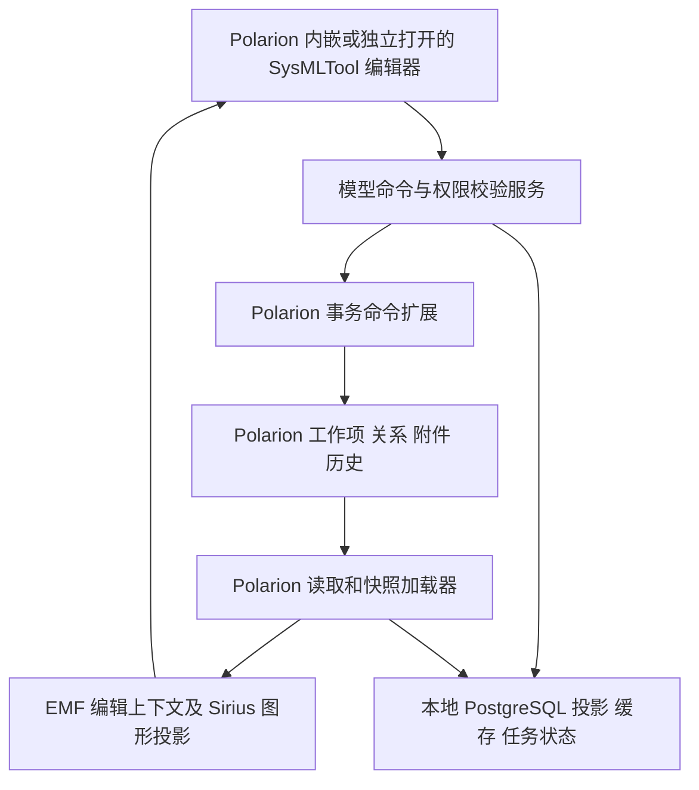

# Polarion 作为模型数据底座的 AI 开发实施方案

日期：2026 年 11 月 17 日。适用仓库：`C:\SysMLTool`。执行对象：Codex、Claude Code 或维护该仓库的开发人员。

本文规定如何把现有“SysMLTool 保存模型并同步 Polarion”改造为“Polarion 保存权威模型，SysMLTool 提供模型设计能力”。默认以现有 Polarion 2512 环境验证，沿用 Java 21、Sirius Web 2025.8.11 和当前自定义 EMF 元模型，不同时开展完整 SysML v2 内核迁移。

**交付目标：设计元素、关系、图定义、布局和模型版本可以持久化在 Polarion；清空指定模型的本地投影后，可以仅从 Polarion 重建并继续编辑。** 本地 PostgreSQL 仍可保存运行状态、缓存、任务和投影，但不再是该模式下已保存模型的唯一来源。

本文是待实施规范。出现的目录、接口、字段和配置，除明确列为已有者外，均为拟新增设计，不表示当前已经实现。本文仅授权编码任务的定义，不代替实际环境变更授权。

## 1 产品范围和不可变原则

### 1.1 首期范围

首期支持 Model、PartDefinition、Part、InterfaceDef、Port、Connection、ItemFlow、Allocate、RequirementReference、Diagram，覆盖 BDD、IBD、SA／LA／PA、分配矩阵及基本需求追溯。

已有参数和行为对象必须在存储编解码层完整往返保存；首期不新增其语义。如果暂不能完整编码某类对象，包含它们的模型必须被迁移预检拒绝，禁止静默遗漏。时序图继续只读，行为继续不执行。

首期只允许主干写入，不直接复用现有本地分支作为 Polarion 分支。现有本地模式中的分支、合并仍可使用；在 Polarion 数据底座模式中，相关入口明确禁用，直至独立设计并验收。

### 1.2 必须满足的原则

1. 每个模型只有一种存储模式，禁止在同一模型上同时启用旧双向同步和新持久化。
2. 已确认保存的模型数据必须存在于 Polarion，不能只写入本地数据库后显示成功。
3. 所有写入使用经验证的调用者身份，不以服务账号绕过用户权限；SSO Cookie 不能自动充当 Polarion API 写入凭据。
4. 同一模型命令涉及多个对象时，保存结果必须全部生效或全部不生效。多个 REST 请求不等于一个事务。
5. UUID 是稳定身份；工作项 ID、业务编号和显示名称分开保存。
6. 布局与模型语义分开保存；拖动过程不得逐帧写入 Polarion。
7. 写冲突返回明确冲突，不允许后写覆盖先写而不提示。
8. 现有模型默认保持 `LOCAL` 模式；新模式通过功能开关和逐模型迁移启用。
9. 通过支持的 Polarion API／SDK 访问，不直接写 Polarion 数据库或仓库文件。
10. 读取、缓存、历史快照和报告都必须执行权限检查，不能因模型缓存而泄漏受限工作项内容。

## 2 当前代码基础与改造边界

| 当前实现 | 复用方向 | 需要改变的地方 |
|---|---|---|
| `metamodel/sysarch.ecore` | 首期模型语义及约束 | 必要时增加稳定 UUID；不把现有业务 id 当作天然全局 UUID |
| `backend/.../sync/polarion/PolarionClient.java` | HTTP、限流、错误处理及当前用户验证 | 扩展读取字段、分页、关系、附件；新增事务扩展客户端 |
| `backend/.../sync/model/SiriusModelGateway.java` | EMF 编辑上下文调度与读取 | 新模式改为投影入口，不再承担双向同步真相来源 |
| `backend/.../view/sirius/ToolFactory.java` | 图形操作与命令映射 | 新模式所有语义修改必须经过统一提交服务 |
| `backend/.../view/sirius/SysarchPaletteProvider.java` | 调色板 | 工具进入统一命令路径 |
| `backend/.../view/sirius/ProjectionCache.java` | 图形缓存 | 增加模型版本及权限作用域，避免跨用户缓存串读 |
| `backend/.../baseline/` | 结构快照、差异算法 | 权威版本清单迁往 Polarion；本地缓存可重建 |
| `backend/.../branch/`、`merge/` | 保留 LOCAL 模式行为 | 新模式首期明确拒绝分支创建和合并 |
| `backend/.../access/`、`identity/` | 身份及项目隔离 | 增加工作项可见性和写权限检查 |
| `frontend/src/sync/` | 复用授权核验经验 | 新模式换为加载、保存、冲突与重建流程 |
| `polarion-sso/` | 参考插件构建、部署及身份对接 | 新事务能力建议独立插件模块，不把存储职责塞入 SSO |
| `backend/.../report/`、`export/`、`solver/`、`sysmlimport/` | 现有功能 | 写回、导入、修复、删除同样经过新提交服务 |

以上路径中的 `backend/...` 指 `backend/src/main/java/com/example/sysarch/`。实际实现前用 `rg` 核对接口和调用关系，避免按旧文档猜测类签名。

## 3 目标运行框架



### 3.1 两种存储模式

新增逐模型设置：`LOCAL` 和 `POLARION`，全局开关默认关闭新模式。已有项目绑定只表达访问与业务关联，不自动等于启用新存储模式。

`LOCAL`：保持现有 EMF／Sirius 持久化和显式同步路径。

`POLARION`：Polarion 是已保存语义与布局的权威来源。本地 EMF 是某个已提交模型版本的可重建投影，编辑暂存和提交状态必须明确区分。旧 push／pull、定时同步和一致性修复不得再修改同一模型。

不删除 Sirius 需要的本地表。先提供 Repository 抽象和适配器，再逐模型切换，禁止全库一次性替换。

### 3.2 写入的默认技术决策

**默认采用 Polarion 服务端事务扩展提交模型命令。** 官方 SDK 提供事务服务，但目标版本下的跨工作项原子性、并发冲突及调用者身份传播必须在 M0 实测；不能仅凭 API 名称判定完成。

REST 用于常规读取、分页、附件和能力探测。不得假设 REST 支持跨请求事务、通用 `If-Match` 或服务器端 CAS。若 M0 无法证明默认方案的原子提交与并发控制，保持新模式只读，输出阻断报告，不擅自改成“多个 REST 请求加本地锁就是原子保存”。

如客户禁止安装插件，另立 ADR 评估不可变提交包加受控发布指针的方案；在发布指针条件更新尚未解决前，也只能实现只读或人工导入导出，不承诺多人安全编辑。

## 4 Polarion 数据模型

### 4.1 工作项类型

新增类型使用 `sysarch` 前缀，避免与现有配置冲突。配置安装以差异计划执行，不覆盖客户已有类型、字段或工作流。

| 类型 ID | 作用 | 主要字段 |
|---|---|---|
| `sysarchModel` | 模型根与版本入口 | modelUuid、schemaVersion、headVersion、headCommitId、headManifestHash |
| `sysarchElement` | 定义、部件、接口、端口等模型对象 | elementUuid、modelUuid、elementKind、layer、semanticPayload |
| `sysarchRelation` | 有属性的连接、流和分配等 | elementUuid、modelUuid、relationKind、sourceUuid、targetUuid、semanticPayload |
| `sysarchDiagram` | 图定义及布局 | diagramUuid、modelUuid、diagramKind、semanticOwnerUuid、layoutVersion、布局附件引用 |
| `sysarchCommit` | 不可变提交及恢复信息 | commitId、commandId、requestHash、actorId、baseVersion、resultVersion、manifestHash |
| `sysarchBaseline` | 业务命名的已提交版本 | baselineUuid、modelUuid、commitId、label、发布说明 |

需求优先引用原 Requirement 工作项，不复制为另一个需求真相。`RequirementReference` 保存目标项目／工作项／选定修订及模型端稳定 UUID。默认只读需求正文；修改需求仍走原 Polarion 需求维护流程。

统一类型加 `elementKind` 是首期默认，降低类型配置数量；可以后续按业务拆分类型，但迁移需保留 UUID 和编解码版本。

### 4.2 公共字段和身份

建议字段 ID：`sysarchModelUuid`、`sysarchElementUuid`、`sysarchElementKind`、`sysarchSchemaVersion`、`sysarchLayer`、`sysarchPayload`、`sysarchManaged`、`sysarchHeadVersion`、`sysarchHeadCommitId`、`sysarchHeadManifestHash`、`sysarchCommandId`、`sysarchRequestHash`。

UUID 使用标准随机 UUID 字符串；业务编号继续保留，例如 PD-001、PT-001。现有工作项映射必须使用 `(Polarion server, projectId, workItemId)` 定位，不能只用短 ID。

唯一性要求：同一模型中 elementUuid 唯一；一个托管工作项不能属于两个模型；模型 UUID 在一个目标服务器范围内唯一。Polarion 自定义字段不自动提供数据库唯一约束，必须由事务扩展及注册入口验证，并通过并发创建测试证明。

### 4.3 字段与 Payload 的权威关系

语义结构以版本化 `semanticPayload` 为完整编码；显式公共字段提供查询及展示。二者必须由同一命令生成并在同一事务校验一致，不能分别由不同来源维护。

示例仅说明内部 DTO，不是 Polarion 原生 REST 请求体：

```json
{
  "schemaVersion": "1.0",
  "elementUuid": "2b31f827-f8bd-4fa9-8bc1-b808567f9bb1",
  "businessId": "PT-001",
  "kind": "Part",
  "name": "左前轮电机",
  "layer": "PHYSICAL",
  "ownerUuid": "03a1e4ca-b1ce-423c-b871-f28fa31aad07",
  "typeUuid": "4a85185d-22ba-4b55-ab9f-9ffb56f738ea",
  "multiplicity": "1",
  "stereotypes": [],
  "description": ""
}
```

编解码规则：字段排序固定；集合是否有序按元模型定义；数字和换行规范化；空值与缺省值分开规定；hash 计算只包含规范化语义，不含获取时间或临时路径。可用成熟规范化 JSON 实现，禁止自行随意拼接 JSON。

`sysarchPayload` 字段长度必须在 M0 验证。超过安全上限的对象使用内容寻址附件；单个对象不能一部分读字段、一部分读未受版本约束的最新附件。默认建议单对象 64 KiB、单模型提交包 20 MiB、单命令 200 个变更作为可配置保护值，属于初始设计限制，不是 Polarion 官方能力上限。

### 4.4 关系表达

| 关系 | 权威表达 | Polarion 中的展示 |
|---|---|---|
| 包含 | 子对象 `ownerUuid` | 派生 `sysarchContains` 链接 |
| 类型引用 | 实例 `typeUuid` | 派生 `sysarchTypedBy` 链接 |
| 继承 | 定义 `superTypeUuids` | 派生 `sysarchSpecializes` 链接 |
| Connection | 独立关系对象，含两端 Port UUID 和部件路径 | 端点链接及关系工作项 |
| ItemFlow | 独立对象，引用连接、源端及目标端 | 派生流链接 |
| Allocate | 独立对象，含源、目标和 rationale | 派生 `sysarchAllocates` 链接 |
| Satisfy／Verify | 版本化关系记录，含模型对象和需求引用 | 对需求工作项的相应链接角色 |

链接用于 Polarion 导航与查询，完整语义来自规范化模型记录。服务端校验并重建派生链接。用户不能只改链接就隐式改变模型；发现直接修改必须标记外部漂移并阻止静默覆盖。

连接必须保存实例路径，不能只保存接口类型，避免同一类型的多个部件端口被合并。跨模型引用首期默认拒绝；跨项目需求引用须显式允许且同时验证双方可见性。

### 4.5 图形与布局

每张图记录图 UUID、类型、语义 owner、筛选范围、显示元素集合、样式配置版本及布局引用。布局 JSON 保存节点位置、尺寸、端口位置和折点；不复制完整语义对象。

`layoutVersion` 独立计数，防止单纯移动节点造成语义冲突；发布清单记录语义版本和选定布局版本，允许完整恢复。布局的更新仍需权限、版本和幂等检查，不能绕过提交服务。

## 5 版本 快照与历史重建

模型头使用单调递增 `headVersion`，与 Polarion 仓库修订号分开。任意语义提交必须带 `expectedVersion`。不能把最后读取的一个工作项 revision 当成整个模型版本。

每个成功提交生成不可变提交清单及完整语义快照；首期选择完整快照降低恢复复杂度，后续可优化增量。快照中保存全部托管元素及关系、UUID 到工作项映射、图定义、布局内容哈希、需求引用和选定修订。历史布局使用不可变内容寻址文件，不能只记录可变附件的最新下载 URL。

提交包放在 Polarion 附件中，文件名含内容 SHA-256；摘要不含提交后才能获得的本次仓库 revision，避免循环依赖。结果版本和 commitId 可在事务开始前生成，最终工作项修订可提交后补充为诊断信息，不作为重建唯一依赖。

模型头只有在对应快照和语义工作项全部验证成功时才前移。若附件只能先于事务上传，未被头或有效提交引用的附件只是暂存垃圾，不是有效版本；事务失败不应留下部分可见的语义更新。附件保留及垃圾回收按引用扫描，禁止删除历史版本仍引用的文件。

历史快照包含的是模型语义；需求正文默认按选定 Polarion 修订重新读取。若提供带需求正文的发布归档，必须执行依赖权限校验，且不能因正文被打包进快照而绕过后来收紧的读取权限。

## 6 提交协议 原子性和幂等

### 6.1 命令协议

拟新增 SysMLTool API：

```http
POST /api/v1/models/{modelUuid}/commands
GET  /api/v1/models/{modelUuid}/commands/{commandId}
GET  /api/v1/models/{modelUuid}/head
GET  /api/v1/models/{modelUuid}/snapshot?version=17
POST /api/v1/models/{modelUuid}/reload
POST /api/v1/models/{modelUuid}/baselines
```

外部 Polarion 事务扩展的路径在 M0 根据 SDK 注册机制确定并写入 ADR，不能凭空假设是 Polarion 官方 REST 端点。SysMLTool 后端通过独立 `PolarionCommandClient` 调用它。

请求示例：

```json
{
  "commandId": "a74604a6-2d65-48e4-8aab-5a41973f9af0",
  "expectedVersion": 17,
  "schemaVersion": "1.0",
  "operations": [
    {
      "kind": "RenameElement",
      "elementUuid": "2b31f827-f8bd-4fa9-8bc1-b808567f9bb1",
      "name": "左前驱动电机"
    }
  ]
}
```

请求中不接受客户端指定 `actorId` 作为真实身份。服务端取得已验证用户，绑定 commandId、模型、规范化 requestHash 和 expectedVersion。重复 commandId 且请求不同必须返回 409，不能复用旧结果。

### 6.2 服务端提交顺序

1. 验证调用者身份及模型、所有受影响对象、需求依赖的权限；验证大小、操作类型和 schemaVersion。
2. 按 `(modelUuid, commandId)` 查询 Polarion 中的命令记录；已有成功结果则验证 requestHash 后返回原结果。
3. 在可回滚的候选 EMF 副本应用操作，执行现有 OCL、层级、端口类型和引用完整性检查。不得先修改共享已提交投影。
4. 准备规范化快照及布局内容；必要时先上传不可变暂存附件，但不改变权威模型头。
5. 进入 Polarion 写事务，重新读取模型头、权限及相关对象的预期修订，检查 expectedVersion 和外部漂移。
6. 在同一事务中创建／更新／退役工作项、更新派生链接、创建命令提交记录，并前移模型头。根对象参与写冲突检测；并发事务必须只有一个成功。
7. 提交事务。冲突或异常则回滚所有语义修改；不能捕获异常后仍返回成功。
8. 用成功提交结果更新本地投影，向订阅发送已提交版本。若投影失败，标记缓存落后并重新加载；Polarion 成功结果仍是最终事实。

第 5—6 步的并发效果必须通过两个独立客户端和服务进程验证，不能仅靠 SysMLTool JVM 内锁。若目标 Polarion 的事务隔离不足以保护模型头，需要采用 SDK 支持的锁或版本检查机制，并记录集群行为；未验证前禁止开放多人写入。

### 6.3 超时与重试

客户端超时不等于事务失败。返回不确定状态时，以原 commandId 查询 Polarion 命令记录；确认成功则回放结果，确认不存在且符合重试条件才重试。禁止生成新 commandId 盲目再次创建工作项。

本地命令状态：`PREPARED`、`SUBMITTING`、`COMMITTED`、`REJECTED`、`UNKNOWN`。只有 `COMMITTED` 显示“已保存”。进程重启后 `SUBMITTING` 转 `UNKNOWN` 并核对远端，不能默认失败或成功。

请求内 PAT 仅驻留内存，不写任务表、日志、异常、命令清单或浏览器持久化存储。恢复任务无用户凭据时暂停，要求原用户重新授权；不自动换成管理员令牌。

| HTTP 状态 | 语义 | 客户端处理 |
|---|---|---|
| 200／201 | 已确认提交或幂等命中 | 更新已保存版本 |
| 401 | 未授权或凭据过期 | 保留未保存意图并请求重新授权 |
| 403 | 目标对象权限不足 | 不显示敏感对象详情，不提交 |
| 409 | 版本、请求 hash 或外部漂移冲突 | 展示冲突，重新加载或人工重应用 |
| 413 | 超过配置上限 | 引导拆分，不擅自分多次造成部分提交 |
| 422 | 模型或 schema 校验失败 | 展示字段与规则，不改变模型 |
| 429 | 限流 | 有界退避，保存 commandId，遵守 Retry-After |
| 503／504 | 服务不可用或结果未明 | 根据是否已提交请求进入 UNKNOWN 并查询结果 |

### 6.4 删除与撤销

首期采用逻辑退役，保留 UUID 和历史；级联删除必须先生成影响清单，在单个命令中检查引用。存在外部引用时默认拒绝。永久物理删除作为独立维护任务，不由画布 Delete 操作执行。

Undo 是基于当前版本的新反向命令，不是本地撤销后假装远端同步。涉及依赖变化或他人修改时允许拒绝撤销并说明冲突。

## 7 Sirius 编辑路径改造

这是首期最大的实现风险：只添加一个保存按钮不能阻止原生 Sirius 路径直接修改本地模型。

统一入口拟命名 `ModelCommandService`。必须清点并拦截：画布创建、连线、改名、属性面板、模型树、原生删除、矩阵操作、导入、求解写回、同步修复、分支合并、后台脚本和其他 GraphQL mutation。

新模式默认采用“命令成功后更新共享投影”。需要即时交互时，使用隔离候选副本或客户端暂态，不允许未提交内容广播到其他会话。若现有 Sirius 工具接口无法在不破坏线程模型的情况下适配，先将该操作禁用或替换为自定义命令工具，不能保留旁路。

远端调用不能持有本地数据库长事务；网络线程和 Sirius 编辑上下文之间通过已验证的调度机制交接。提交前基于版本构造候选副本，提交后按版本序列更新上下文，避免旧响应覆盖新响应。

新模式所有原生 mutation 采用白名单；未知语义写入默认拒绝。加载投影和内部提交后刷新要使用不可由外部输入伪造的内部上下文，避免递归提交。

布局批量提交采用 500—1000 ms 防抖或操作结束提交作为初始交互策略，并配显式保存状态。参数是建议值，最终通过浏览器任务测试确定。

## 8 读取 权限和缓存

### 8.1 加载顺序

验证当前用户 → 读取模型根和头版本 → 获取对应清单与快照 → 校验 hash 和 schema → 检查对象及需求依赖可见性 → 两阶段构建 EMF 对象及引用 → 执行校验 → 建立 Sirius 投影。

先创建所有 UUID 对象，再解析引用；缺失引用、重复 UUID、未知类型或不支持 schema 不能静默跳过。加载失败不覆盖上一个有效投影。

从清单加载一致快照，不能通过分页查询不断变化的“最新工作项”拼装成一个模型版本。索引用于发现模型和外部漂移检测，不作为刚提交后读己之写的唯一依据。

### 8.2 权限规则

本地项目成员判定是前置条件，不能替代 Polarion 对象权限。首期采取全模型授权策略：若用户不能读取必要托管元素，则拒绝打开完整模型，不自动展示一个删减后看似完整的图。需求引用可显示不含标题正文的不可见占位，但不进入报告内容，且有明确提示。

缓存至少按服务器、项目、模型 UUID、模型版本、schemaVersion 及权限作用域区分。权限结果有短 TTL；每次写入和敏感导出重新核对。断线或权限校验失败不能继续把缓存当作允许访问的依据。

WebSocket 在握手、订阅和事件分发阶段检查访问；权限收紧时停止发送模型及报告内容。不得把高权限加载的 EMF 快照直接共享给低权限会话。

### 8.3 Polarion 原生编辑

首期托管语义字段及派生链接仅由模型命令扩展维护。通过配置权限、工作流或扩展校验限制直接修改，具体机制由 M0 验证。

管理员或其他扩展仍可能修改数据，读取及提交时必须检查快照与当前托管工作项的修订／内容漂移。发现漂移进入 `EXTERNAL_CHANGE` 状态，提供差异和显式“采用外部修改／按模型修复”操作，禁止静默覆盖。需求正文按原流程更新，不属于托管语义漂移。

## 9 模块 接口与配置

拟新增目录：

```text
backend/src/main/java/com/example/sysarch/storage/
  ModelRepository.java
  ModelStorageMode.java
  ModelCommandService.java
  ModelCommandController.java
  ModelCodec.java
  local/LocalModelRepository.java
  polarion/PolarionModelRepository.java
  polarion/PolarionCommandClient.java
  polarion/PolarionSnapshotLoader.java
  polarion/PolarionProjectionRebuilder.java
  polarion/ExternalChangeDetector.java
polarion-model-store/
  src/main/...
frontend/src/storage/
tests/acceptance/polarion-store/
docs/polarion-store/
```

`polarion-model-store` 为拟新增独立模块，其运行 Java／OSGi／依赖版本按目标 Polarion SDK 确定，不能直接套用后端 Java 21。不把 Polarion 私有 SDK JAR 公开提交到仓库；构建从配置的 SDK 目录取得并记录版本。

接口草案仅定义职责，不锁定 Java 细节：

```java
interface ModelRepository {
    ModelHead head(ModelKey key, UserAuthorization authorization);
    ModelSnapshot load(ModelKey key, Version version, UserAuthorization authorization);
    CommitResult commit(ModelKey key, ModelCommand command, UserAuthorization authorization);
    CommandStatus commandStatus(ModelKey key, UUID commandId, UserAuthorization authorization);
}
```

`UserAuthorization` 不允许序列化 token；快照 DTO 不暴露凭据。接口中不得以字符串 username 代替已验证授权上下文。

拟新增环境变量：

| 配置 | 默认值或约束 |
|---|---|
| `SYSARCH_POLARION_STORE_ENABLED` | false |
| `SYSARCH_POLARION_STORE_COMMAND_URL` | 仅受信目标，不能由请求参数指定 |
| `SYSARCH_POLARION_STORE_MAX_COMMAND_OPERATIONS` | 200，M0 后调整 |
| `SYSARCH_POLARION_STORE_MAX_SNAPSHOT_BYTES` | 20971520，M0 后调整 |
| `SYSARCH_POLARION_STORE_ALLOW_BRANCHES` | false，首期不得启用 |
| `SYSARCH_POLARION_STORE_PERMISSION_TTL` | 建议短 TTL，实际值在权限验收确定 |

逐模型配置保存在本地登记表并能从 Polarion 模型根重新发现；不能只靠本地登记表才知道某模型存在。数据库变更使用 Liquibase，保留 LOCAL 模式和现有数据。

## 10 迁移 切换和回退

### 10.1 迁移步骤

1. 对单个源模型做只读预检，列出全部类型、关系、未知字段、目标类型配置、既有 WI 绑定及权限。
2. 固定迁移源版本并冻结源写入，生成完整快照、UUID 分配和现有链接清单。
3. 在独立测试项目先执行 dry-run；输出将创建、采用、关联或拒绝的对象，不直接覆盖现有工作项。
4. 已有旧同步工作项默认作为关联目标保留；仅在字段、类型、权限和所有权完全核对后显式采用。不得默认删除再创建。
5. 大模型分批上传到未发布的迁移暂存区，最后验证完整性并原子发布根指针。暂存对象不得被正常模型发现入口当成已发布对象。
6. 从 Polarion 独立读取新模型，与源快照比较对象、属性、关系、布局及需求引用。
7. 记录源到目标映射，切换该模型为 POLARION，关闭旧同步和相应调度，再开放新模式写入。
8. 在隔离实例清空该模型本地投影后重建，验证图、报告和导出；不通过则不完成切换。

迁移任务使用固定 migrationId，失败重试不重复创建。跨多个提交的暂存迁移与正常用户命令分开设计，不能把正常命令自动拆批而放弃原子性。

### 10.2 回退规则

启用前可直接取消未发布迁移。启用后如果尚无新增写入，可按记录恢复旧模式。若已有新提交，必须先导出最新 Polarion 快照并重建 LOCAL 模型，再切换，不能直接恢复旧数据库导致新设计丢失。

回退不删除 Polarion 历史和工作项，只把模型登记为停止写入或归档。恢复操作必须校验 modelUuid 和迁移映射，不能影响其他模型。

## 11 AI 分阶段开发任务

按 M0—M8 顺序执行。每阶段结束提交代码、测试结果、设计决策和剩余阻断，未经验证的远端能力不得写成已完成。本文不要求自动提交 Git；是否提交遵守用户当次指令。

### M0 目标环境能力探针

**目标：证明默认事务路线可行，所有后续写功能依赖该阶段。**

任务：确认目标 Polarion 版本、SDK、插件构建运行环境、支持的认证方式和命令扩展注册机制；测试字段与附件长度；以两个独立调用者验证模型头并发冲突；验证多 WI、链接、提交记录和根指针在失败时全部回滚；验证插件使用调用者权限且没有服务账号代写；核对托管字段原生编辑限制。

产物：`docs/polarion-store/M0-capability-report.md`、`ADR-001-transaction-and-identity.md`、可复现探针及清理清单。只读检查先做，实际安装插件或创建数据须使用专用测试项目，并遵守当前环境操作授权。

验收：两个相同 expectedVersion 的竞争提交只有一个成功；注入中途失败不残留部分语义变更；无写权限用户不能通过扩展成功写入；响应超时后可按 commandId 查到准确结果。任一不通过，新模式保持只读。

### M1 仓储抽象和无损编解码

任务：新增 Repository 和 DTO；先以 LOCAL 适配器承接现有行为；实现所有现有 Ecore 类型的规范化编码、引用解析、hash 和 schema 校验；对不支持版本明确失败；添加逐模型存储模式，默认不变。

验收：现有功能回归通过；复杂模型 encode→decode→encode 语义及 hash 一致；覆盖端口实例路径、循环交叉引用、顺序消息、空值、中文、布局和行为／参数对象；未知类型拒绝而非丢弃。

### M2 Polarion 配置与只读重建

任务：提供配置差异清单和幂等安装方案；实现模型发现、根／清单／附件读取、分页及权限检查；实现双阶段 EMF 重建；新模式界面只读；加入附件 hash、大小、schema 和缺失引用检查。

验收：从固定测试数据重建 BDD／IBD／分层图／矩阵；删除隔离实例该模型本地投影后仍可恢复；无权用户无法通过快照、缓存、报告或原生接口读取；本地旧模型不受影响。

### M3 事务命令扩展与提交协议

任务：实现插件命令入口、expectedVersion、对象修订核对、幂等记录、权限、原子提交、逻辑退役、提交包和头指针；新增请求状态查询；实现限流和错误映射。

验收：创建／改名／改属性／连接／分配／删除的事务用例通过；两个进程并发只一方成功；重复命令不重复创建；相同 ID 不同请求返回冲突；提交前后不同位置注入失败能恢复；所有远端操作真实身份可审计。

### M4 全部编辑入口接入

任务：建立 mutation 清单；接入画布、模型树、属性页、矩阵、导入和求解写回；拒绝未适配原生 mutation；成功后才广播已提交版本；UI 展示未保存、保存中、已保存、冲突和未知结果。

验收：任何语义入口都无法只改本地投影；Polarion 故障时不出现假保存；同模型两个浏览器看到相同已提交版本；分支与旧同步在新模式明确拒绝；PAT 不持久化。

### M5 布局 基线 报告与重建

任务：独立布局版本及防抖提交；基线指向 Polarion 不可变提交；报告和导出使用指定版本快照；处理外部修改漂移；提供受控重建操作。

验收：移动节点不改变语义 hash；历史版本能恢复当时布局；需求受限正文不能通过旧报告入口重新导出；快照附件损坏明确失败；从 Polarion 重建后报告及规范化导出一致。

### M6 单模型迁移和回退

任务：实现 dry-run、冻结、暂存迁移、幂等恢复、既有 WI 采用规则、差异报告和逐模型切换；实现有新提交后的回退。

验收：复杂样本无静默丢失；超出范围预检拒绝；中断重跑不创建重复对象；切换后旧同步无法写入；回退保留切换后产生的新设计；其他模型不受影响。

### M7 真实账号 故障和性能验收

任务：两个真实专用账号、两个项目完成正反向授权；测试权限撤销、断线、token 过期、后台重启、Polarion 超时和缓存重建；建立当前版本真实认证负载报告。

建议性能验收目标：500 元素模型首次打开 P95≤5 秒，普通单元素保存 P95≤2 秒，布局保存不得造成每次拖动多次语义写入；这些是初始业务目标，M0 后根据实测与客户要求调整，并记录硬件、网络、对象数量和 payload 大小。

覆盖 500／2000／10000 元素、1／5／10 个编辑者，再评估 30 人；不把原 LOCAL dev 身份压测作为此模式通过证据。万元素若不满足目标，先优化批量加载与快照，不无限提高并发压垮 Polarion。

### M8 试点发布

任务：完成部署包、恢复手册、监控、权限配置、管理员操作说明和用户手册；选择一个真实项目进行四周试点；收集保存失败、冲突、任务耗时和数据恢复结果。

验收：全部阻断项关闭；恢复演练完成；试点交付件、模型和 Polarion 追溯通过评审；未验收的分支、仿真或语言能力不出现在产品承诺中。

## 12 必须覆盖的验收矩阵

| 编号 | 场景 | 预期结果 |
|---|---|---|
| AC01 | 删除隔离实例中该模型本地投影并重启 | 从 Polarion 重建相同语义和布局 |
| AC02 | 创建组件、部件、端口及连接 | UUID、实例路径、端点和类型完整保存 |
| AC03 | 两客户端基于相同版本保存 | 仅一方成功，另一方 409 |
| AC04 | 相同 commandId 重试三次 | 只有一次业务提交，返回同一结果 |
| AC05 | 相同 commandId 携带不同内容 | 409，不执行新内容 |
| AC06 | 多对象写入中途失败 | 工作项、关系和模型头无部分更新 |
| AC07 | 事务成功后网络响应丢失 | 查询 commandId 获得成功，不重复创建 |
| AC08 | 远端成功、本地投影更新失败 | 重载恢复，已提交结果不丢失 |
| AC09 | 账号 A 读取账号 B 项目 | 列表、快照、订阅、报告和下载均受控 |
| AC10 | 模型内一个对象对用户不可见 | 不泄漏其标题、正文或快照内容 |
| AC11 | 已连接会话失去权限 | 停止敏感事件；保存被拒 |
| AC12 | PAT 到期及服务重启 | 不使用服务账号代写，重新授权后可恢复 |
| AC13 | Polarion 原生修改托管字段／链接 | 发现漂移，阻止静默覆盖 |
| AC14 | 需求正文正常更新 | 按需求版本策略刷新，不反写覆盖正文 |
| AC15 | 删除仍被连接引用的端口 | 默认拒绝或原子执行显式级联计划 |
| AC16 | 连续拖动与两个会话改布局 | 有界合并提交，版本冲突可见，语义不变 |
| AC17 | 未知 schema、坏 hash、缺少附件 | 明确失败，不覆盖有效投影 |
| AC18 | 原生 GraphQL／树／导入／求解旁路 | 无法绕过统一提交 |
| AC19 | 已有模型切换后执行旧同步 | 明确拒绝，无双写 |
| AC20 | 迁移中断及启用后回退 | 不重复、不影响其他模型、不丢新增版本 |
| AC21 | 基线恢复及报告生成 | 使用同一固定版本，不拼接最新元素 |
| AC22 | 日志及存储检查 | 不含 PAT、密码、会话密钥和完整授权头 |
| AC23 | LOCAL 模式回归 | 原有功能和默认配置保持可用 |
| AC24 | 已有参数、行为、交互模型迁移 | 完整保留，或在迁移前明确拒绝 |

## 13 测试和交付要求

对编解码、版本竞争、权限、幂等和失败恢复编写有意义的测试。模拟测试不能代替 SDK 原子性与真实双账号测试；SDK 测试环境不可用时如实标记跳过及影响，不伪造成功。

每阶段只运行与改动相关的测试，集成后运行仓库要求的检查。当前 Windows 示例：

```powershell
.\gradlew.bat --offline check
```

前端命令以 `frontend/package.json` 实际脚本为准，不假设存在未定义命令。若离线缺依赖，按环境权限要求申请网络访问，不擅自更换依赖版本。插件构建单独说明所需 SDK，不把 SDK 缺失误报为业务测试通过。

每阶段状态文件统一放在 `docs/polarion-store/implementation-status.md`，记录当前阶段、完成项、改动文件、测试命令及结果、环境验证、阻断和下一步。增加需求→任务→验收编号映射。不要在聊天中连续报“正在写”而不交付阶段文件。

## 14 可直接复制给 Codex 或 Claude Code 的执行指令

### 14.1 首次执行

```text
请在 C:\SysMLTool 中实施 docs/Polarion作为模型数据底座的AI开发实施方案.md。

先读取适用的 AGENTS.md、CLAUDE.md 和本方案，检查当前工作区，保留现有未提交改动。
本轮只实施 M0 能力探针和 M1 仓储抽象／编解码，不直接迁移既有模型或切换运行实例。
先完成不依赖远端变更的代码、测试和具体探针；实际插件安装或真实数据变更按已有授权及环境权限执行。

关键约束：
1. Polarion 模式必须使已保存模型可以从 Polarion 独立重建。
2. 默认 LOCAL 模式不变，保留现有功能。
3. 不把多个 REST 调用或本地锁当成远端原子事务。
4. 写入沿用真实调用者权限，不持久化 PAT，不自动使用管理员令牌。
5. 全部现有模型对象无损编码；不支持的类型明确拒绝。
6. M0 未验证原子性、身份或并发控制时，新模式只能只读。

先生成 docs/polarion-store/implementation-status.md 与 M0 探针计划，随后完成可执行工作。
阶段结束说明改动、测试、已证实能力和阻断，不把 mock 结果写成真实 Polarion 验证。
```

### 14.2 续接执行

```text
继续实施 docs/Polarion作为模型数据底座的AI开发实施方案.md。
先读取 docs/polarion-store/implementation-status.md，核对实际代码和测试后从未完成任务继续。
保留既有改动，不重做已完成且有效的检查。
按 M0—M8 依赖执行；未验证的前置条件不得跳过。
每阶段更新状态、ADR 和验收映射，明确本地自动测试与真实环境结果。
```

### 14.3 阶段审查

```text
按 docs/Polarion作为模型数据底座的AI开发实施方案.md 审查当前实现。
重点检查：权威来源、编辑旁路、多对象事务、并发版本、幂等、超时结果查询、调用者身份、
快照和缓存权限、布局独立、完整编码、旧同步禁用、迁移回退和本地投影重建。
输出按严重度排序的问题，并指出文件位置、触发步骤、影响和修复建议。
未经真实环境验证的能力标记待验，不用测试数量代替验收结论。
```

## 15 官方依据与目标版本核查

以下资料支持接口选择，不替代 M0 的目标版本实测。核查日期：2026 年 11 月 17 日。

| 官方资料 | 支持内容及边界 |
|---|---|
| [Polarion 2512 REST API](https://developer.siemens.com/polarion/2512/rest-api-spec.html) | 工作项、关系及附件接口；不据此推定跨请求事务 |
| [2512 基础概念](https://developer.siemens.com/polarion/2512/basic-concepts.html) | 字段、关系、修订及分页；不能假定任意基线查询已支持 |
| [2512 附件说明](https://developer.siemens.com/polarion/2512/advanced-concepts.html) | 附件内容读写；应用需自行限制大小、校验格式和 hash |
| [2512 认证](https://developer.siemens.com/polarion/2512/authentication.html) | 可用认证机制；实际插件认证入口需单独验证 |
| [事务服务 SDK](https://testdrive.polarion.com/polarion/sdk/doc/javadoc/com/polarion/platform/ITransactionService.html) | Polarion 事务 API；具体 SDK 签名及原子性以目标安装验证 |
| [TransactionExecuter](https://testdrive.polarion.com/polarion/sdk/doc/javadoc/com/polarion/platform/TransactionExecuter.html) | 事务执行帮助类；默认只读，写入模式需按 SDK 明确设置 |
| [Polarion SDK 入口](https://testdrive.polarion.com/polarion/sdk/index.html) | 插件开发及示例；不直接照搬其他版本依赖 |
| [2512 REST 限制](https://developer.siemens.com/polarion/2512/limitations-and-known-issues.html) | 目标版本功能缺口核对 |

## 16 完成定义

只有当一个真实模型在新模式中完成设计、保存、双账号协作、版本恢复、报告输出，并且在删除隔离实例本地投影后仍能从 Polarion 重建，才能认定“Polarion 作为数据底座实现模型设计”成立。

完成后仍需按实际范围描述产品：这是当前自定义模型语义的 Polarion 存储和设计平台，不自动获得完整 SysML v2／KerML、完整 Cameo 互操作、行为仿真或多节点高可用能力。
