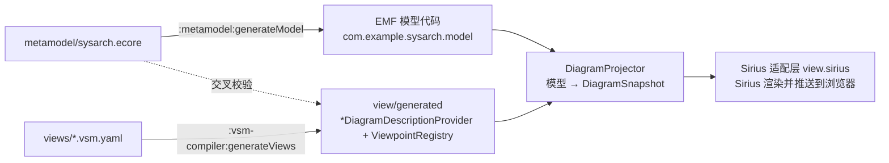
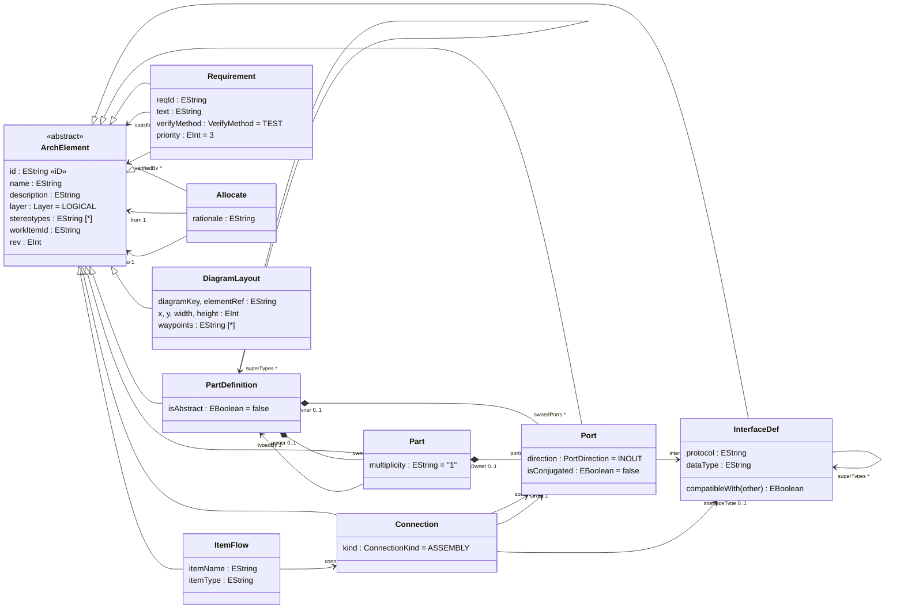

# SysArch Studio：元模型与视图说明

本文对应 spec T9 第 1 步，内容包括：

- 元模型及各类元素的字段（含 P1 的元模型 v1.1：接口实体、需求追溯引用）；
- BDD、IBD 以及 P1 的 SA / LA / PA 分层视图、分配矩阵、需求追溯矩阵如何从模型映射出来；
- 新增一张视图的完整步骤。

文中的规则以代码为准，引用的文件都在仓库里：

| 规则 | 文件 |
|---|---|
| 元模型 | `metamodel/sysarch.ecore` |
| 视图 | `views/*.vsm.yaml`；分层视图由 `views/_templates/` 的模板生成 |
| DSL 字段 | `views/schema/vsm.schema.json` |
| 投影规则 | `backend/.../view/projection/DiagramProjector.java` |

---

## 1. 总览



三条原则：

1. **模型是唯一事实来源**（spec §5.1）。图上每个节点、每条边都对应一个模型元素。删除元素，图上的节点和连线随之消失。布局单独保存，和模型分开。
2. **视图是声明出来的，不是手写的**：
   - 新增或修改视图，只改 YAML，然后重新生成；不改 Java。
   - 运行时不解析 YAML，后端只读取生成的代码。
   - 生成结果逐字节确定，CI 会比对 sha256。
3. **生成代码不依赖 Sirius**：
   - `view.generated` 只使用我们自己的描述符 API（`view.api`）。
   - 由手写的适配层（`view.sirius`）把描述符映射成 Sirius Web 的 `DiagramDescription`。
   - 因此升级 Sirius 不会影响生成代码。

---

## 2. 元模型

包名 `sysarch`，nsURI `http://example.com/sysarch/1.0`。生成的代码在 `com.example.sysarch.model`，不要手工修改，改了 Ecore 之后运行 `./gradlew :metamodel:generateModel` 重新生成。

### 2.1 类图



上图中 `*--` 表示包含（containment），`-->` 表示普通引用。三组包含关系都带配对的 `eOpposite`，如果不配对，EMF 的通知链会断，自动同步就收不到变更事件。

### 2.2 枚举

| 枚举 | 取值 |
|---|---|
| `Layer` | `OPERATIONAL` → `SYSTEM` → `LOGICAL`（LA）→ `PHYSICAL`（PA）→ `EPBS` |
| `PortDirection` | `IN`、`OUT`、`INOUT` |
| `ConnectionKind` | `ASSEMBLY`、`DELEGATION`、`ITEM_FLOW` |
| `VerifyMethod` | `ANALYSIS`、`INSPECTION`、`TEST`、`DEMONSTRATION` |

层次通过 `layer` 枚举加 `stereotypes` 表达，不复用 Capella 的元模型。

### 2.3 公共字段（`ArchElement`，所有元素都有）

| 字段 | 类型 | 说明 |
|---|---|---|
| `id` | EString（EMF iD） | 元素 id，例如 `PD-001`；图节点和 Polarion 绑定都用它。为空时使用资源内的 URI fragment（`ElementIds.of`） |
| `name` | EString | 名称；约束 `NameNotEmpty` |
| `description` | EString | 说明 |
| `layer` | Layer | 所在层，默认 `LOGICAL` |
| `stereotypes` | EString [*] | 构造型，例如 `system`、`ecu` |
| `workItemId` | EString | 预留字段；实际绑定关系存在 `polarion_link` 表中 |
| `rev` | EInt | 修订计数，推送时写入绑定记录 |

### 2.4 各类元素

**PartDefinition（块）**：BDD 和 IBD 的根元素类型。

| 字段 | 类型 | 多重性 | 说明 |
|---|---|---|---|
| `ownedParts` | Part | 0..* 包含 | 内部部件，opposite 为 `Part.owner` |
| `ownedPorts` | Port | 0..* 包含 | 定义级端口，opposite 为 `Port.owner`；在 IBD 中画在图框上 |
| `superTypes` | PartDefinition | 0..* | 泛化 |
| `isAbstract` | EBoolean | 1 | 抽象块，BDD 使用 `abstractBlock` 样式，可以被 `hideAbstract` 过滤 |

**Part（部件）**：块的一次使用。

| 字段 | 类型 | 多重性 | 说明 |
|---|---|---|---|
| `owner` | PartDefinition | 0..1 | 所属块 |
| `typedBy` | PartDefinition | **1**（必填） | 部件的类型；为空时 EMF 校验标红 |
| `ports` | Port | 0..* 包含 | 部件上的端口，opposite 为 `Port.partOwner`；在 IBD 中画在部件边框上 |
| `multiplicity` | EString | 1 | 多重性，默认 `"1"`，IBD 副标签显示为 `类型 [1]` |

**Port（端口）**

| 字段 | 类型 | 多重性 | 说明 |
|---|---|---|---|
| `owner` | PartDefinition | 0..1 | 定义级端口的所属块 |
| `partOwner` | Part | 0..1 | 部件端口的所属部件 |
| `direction` | PortDirection | 1 | 默认 `INOUT` |
| `interfaceType` | InterfaceDef | 0..1 | 接口（P1 起是对接口实体的引用，P0 是字符串，旧数据加载时自动迁移）。约束 `InterfaceTypeRequired`：方向不是 `INOUT` 时必填 |
| `isConjugated` | EBoolean | 1 | 共轭端口 |

**Connection（连接）**：只能作为资源根，没有元素包含它。

| 字段 | 类型 | 多重性 | 说明 |
|---|---|---|---|
| `source`、`target` | Port | **1** | 两端端口 |
| `kind` | ConnectionKind | 1 | 默认 `ASSEMBLY`；决定 IBD 的边样式 |
| `interfaceType` | InterfaceDef | 0..1 | 连接的接口（P1 T3 起是引用）；连线时取源端口的接口；IBD 边标签 `{interfaceType}`、分层视图 `{interfaceType.name}` |

**ItemFlow（项流）**：只能作为资源根。

| 字段 | 类型 | 多重性 | 说明 |
|---|---|---|---|
| `connection` | Connection | 0..1 | 所在连接 |
| `itemName`、`itemType` | EString | 0..1 | 流动项，IBD 标签为 `{itemName} : {itemType}` |

**Requirement（需求）**：只能作为资源根。

| 字段 | 类型 | 多重性 | 说明 |
|---|---|---|---|
| `reqId` | EString | 0..1 | 需求编号，例如 `DC-REQ-001` |
| `text` | EString | 0..1 | 需求文本；**由 Polarion 写入**（spec §6.2），拉取时从 Work Item 描述同步过来 |
| `verifyMethod` | VerifyMethod | 1 | 默认 `TEST` |
| `priority` | EInt | 1 | 默认 3 |
| `satisfiedBy`、`verifiedBy` | ArchElement | 0..* | Satisfy / Verify 追溯（P1） |

**InterfaceDef（接口，P1）**：只能作为资源根。

| 字段 | 类型 | 多重性 | 说明 |
|---|---|---|---|
| `protocol` | EString | 0..1 | 协议；约束 `ProtocolRequired`，为空时在 Protocol 字段标红，不阻止保存 |
| `dataType` | EString | 0..1 | 数据类型 |
| `superTypes` | InterfaceDef | 0..* | 接口继承 |
| `compatibleWith(other)` | 操作 | | 同一实体，或者沿 `superTypes`（可跨多层）一方是另一方的祖先；Java 实现带缓存（`InterfaceCompatibility`），OCL 直接调用 |

**Allocate（分配）**：只能作为资源根。

| 字段 | 类型 | 多重性 | 说明 |
|---|---|---|---|
| `from`、`to` | ArchElement | **1** | 被分配元素 → 承载元素 |
| `rationale` | EString | 0..1 | 理由 |

`DiagramLayout` 也继承自 `ArchElement`，是 spec 给出的布局记录。实际运行时布局保存在 Sirius 自己的 representation 里，不在模型中，因此投影和一致性检查都会跳过它。

### 2.5 约束（OCL，写在 Ecore 注解中）

约束由 Eclipse OCL Pivot 直接读取 Ecore 的 `.../OCL/Pivot` 注解后求值，Java 里没有重复实现，只补充中文提示和需要高亮的元素。

| 约束 | 所在类 | 表达式（摘要） | 编辑时的处理 |
|---|---|---|---|
| `NameNotEmpty` | ArchElement | 名称非空 | 标红，不阻止保存 |
| `InterfaceTypeRequired` | Port | 方向为 `INOUT`，或者 `interfaceType` 非空 | 标红，不阻止保存 |
| `PortInterfaceAssignable` | Connection | ASSEMBLY 时两端口都设了接口，且 `compatibleWith` 成立（P1 T2，取代 P0 按字符串比较的 `PortTypeCompatible`） | 连线落位时拒绝；改已有连线时回滚 |
| `NoSelfLoop` | Connection | `source <> target` | 同上 |
| `DirectionCompatible` | Connection | ASSEMBLY 时方向不同，或者有一端是 `INOUT` | 同上 |
| `LayerAdjacentOnly` | Allocate | 只能分配到相邻的下一层：OP→SYS→LA→PA→EPBS | 回滚；在一致性报告中列为 R4 |
| `NoSelfAllocate` | Allocate | `from <> to` | 回滚 |
| `ProtocolRequired` | InterfaceDef | 协议非空 | 标红，不阻止保存 |

"回滚"类约束只在它涉及的两端都已填写时才检查。新建的空 Allocate 两端都还没填，不算违规，由 EMF 的必填检查标红提示。

---

## 3. 视图怎样从模型映射出来

### 3.1 VSM 字段（封闭集合，增加字段需要评审）

| 层级 | 字段 |
|---|---|
| 文件 | `vsm`、`viewpoint`、`representations` |
| viewpoint | `id`、`label`、`metamodelUri`、`priority` |
| representation | `id`、`label`、`kind`（diagram / table）、`domainClass`、`synchronization`（auto / manual）、`refresh{mode,budgetMs}`、`autoExpand[{feature,maxDepth}]`、`filters[{id,label,expression}]`、`nodeStyles`、`edgeStyles`、`tools` |
| nodeStyle | `id`、`appliesTo`、`shape`（rectangle / rounded-rectangle / square）、`color`、`borderColor`、`borderWidth`、`headerBold`、`italic`、`width`、`height`、`isBorderNode`、`affiliationFeature`、`labelPosition`、`labelExpression`、`subLabelExpression`、`compartments[{feature,label,itemExpression}]` |
| edgeStyle | `id`、`label`、`labelExpression`、`domainClass`、`sourceEnd`、`targetEnd`、`routing`（straight / manhattan / spline，Sirius 不支持曲线，spline 画成直线）、`arrow`（hollow-triangle / filled-diamond / open）、`lineStyle`、`color` |
| tool | `id`、`label`、`action`（create-child / create-edge / external-link）、`targetClass`、`containmentFeature`、`linkType`、`validateOnDrop`、`defaults`（create-child 新建时预填的属性，P1） |
| 表格（`kind: table`，P1） | `rows` / `columns`：`{class, filter, labelExpression, groupBy}`；`cells`：`{existsExpression, markSymbol, color}`；`actions[{id, label, action（create-link / delete-link / link）, targetClass, validateOnCreate, feature}]`。表格不能写图的字段（`nodeStyles`、`synchronization` 等），图也不能写表格字段 |

几种表达式的写法：

- **标签**：`{feature}` 或 `{a.b}`，按路径读取属性。
- **过滤**（P1 §3.5）：支持 `not`、`and`、`or`、括号、布尔属性和 `字段 == '值'` / `!=`，例如 `not isAbstract`、`layer == 'LOGICAL'`、`stereotypes == 'ecu'`（含有这个构造型）。**只允许 `layer`、`isAbstract`、`stereotypes` 三个字段**，其他标识符一律报错，即使模型里有这个属性。
- **图层范围**：表达式里用到 `layer` 的过滤器是这张视图的图层范围，始终生效，不出现在过滤开关里；其他过滤器（如 `hideAbstract`）照旧可以开关。
- **单元格**（`cells.existsExpression`）：`and`、`or`、`not`、括号，加上 `属性 == row|column`（单值引用指向行或列元素）和 `属性->includes(row|column)`（多值引用包含它），属性前可写 `self.`。编译器把它翻译成 Java 条件树，运行时不解析。
- **类名**：写成 `sysarch:<EClass>`。

生成器会拒绝以下情况，打印 `views/<文件>:<行> <原因>` 并以退出码 1 结束：

- 未知的类或属性；
- 边的端点不存在；
- 标签里引用了未知的 `{属性}`；
- 边界节点的 `affiliationFeature` 不是容器引用；
- `create-edge` 工具没有设置 `validateOnDrop: true`；
- `create-child` 的目标类型放不进指定的包含属性；
- 过滤表达式语法错误、用了白名单以外的字段、`layer` 的取值不是枚举值；
- `defaults` 写了不存在或不能预填的属性，或者值与属性类型不符；
- 有图层范围的视图里，`create-child` 新建的元素不在本层（`defaults.layer` 必须是本层）；
- 由模板生成的 YAML 被手工改过（与模板展开结果不一致）；
- 表格：单元格表达式语法错误或属性不对（不存在、单值/多值用错、类型和行列对不上）；`create-link` 没有设置 `validateOnCreate: true`，或者单元格表达式不是能直接建出来的 `a == row and b == column` 形式；`groupBy` 不是 `layer`。

### 3.2 所有视图共用的投影规则（`DiagramProjector`）

1. **范围**：图根元素所在资源内的全部元素，按文档顺序排列。
2. **同类节点**：如果节点样式的类型就是根元素的类型（或它的父类、子类），资源里所有这类元素都会显示。BDD 能显示全部块、包括新建的块，靠的就是这条规则。其他节点样式只显示从根元素沿 `autoExpand`（属性、深度）能走到的元素。
3. **边界节点**：画在其 `affiliationFeature` 所指元素的节点上；如果所指元素就是根元素，则画在图框上。
4. **每个元素只对应一个节点**：如果多个样式都适用，`isAbstract = true` 的元素用最后一个样式，其余元素用第一个。
5. **边**：
   - 对边样式所属类型的每个元素，按（源端值，目标端值）各画一条边，两端都有节点才画。
   - 类型和两端都相同的多个边样式互为备选，元素按 `kind` 的取值选用 id 与之相同的那个，否则用第一个。
   - 如果某一端的元素自己没有节点，就画到它的 `typedBy` 节点上，标签从这一端的元素读取。
   - 如果连 `typedBy` 节点也没有，就画到最近的、有节点的容器上（容器的 `typedBy` 也算），标签不变（P1）。分层视图不画端口，连接因此画在端口所属部件的类型块之间。
6. **过滤**：打开的过滤器隐藏表达式为假的元素，连同它们的边界节点和边一起隐藏，模型本身不变。图层范围过滤器始终打开。
7. **自动同步**（`synchronization: auto`）：
   - 模型一变，就重新投影；Sirius 推送整张图，浏览器端做增量更新。
   - 实测 501 个节点时，端到端中位数 69 ms，P95 86 ms。
   - 这类视图不能"从图上移除但保留在模型里"，只能通过过滤器隐藏。

### 3.3 BDD（`views/sysarch-core.vsm.yaml`，`bdd`）

根元素是 `PartDefinition`，`autoExpand` 为 ownedParts（深度 3）和 ownedPorts（深度 1）。

| VSM | 模型 | 图上的表现 |
|---|---|---|
| nodeStyle `block`（PartDefinition） | 资源内的每个块（规则 2） | 白底深蓝边，标题 `{name}`，副标题 `{layer}`，加上端口分栏 `{name} : {interfaceType}` |
| nodeStyle `abstractBlock`（PartDefinition） | `isAbstract = true` 的块（规则 4） | 灰底斜体 |
| edgeStyle `generalization` | `PartDefinition.superTypes` | 空心三角箭头 |
| edgeStyle `composition` | `PartDefinition.ownedParts` → 部件的 `typedBy`（规则 5） | 实心菱形，标签为部件名称 |
| filter `hideAbstract` | `not isAbstract` | 隐藏抽象块 |
| tool `createPart` / `createPort` | 在 ownedParts / ownedPorts 下新建子元素 | 工具面板中的"新建部件"和"新建端口" |
| tool `connect` | 新建 Connection，落位时校验 | 违反 §2.5 中的连接约束时拒绝，模型不变 |
| tool `bindWorkItem` | external-link | P0 尚未实现，目前通过 `/api/v1/links` 绑定 |

示例：演示数据的 BDD 投影结果（来自 `DomainControllerDemoTest`）。

```text
node PD-001 [block] "域控制器" / "LOGICAL"
  ports: -
node PD-002 [block] "感知融合单元" / "LOGICAL"
  ports: -
...
edge PD-001 -> PD-002 [composition] "感知融合"
```

### 3.4 IBD（`views/sysarch-ibd.vsm.yaml`，`ibd`）

根元素是 `PartDefinition`，即"这个块的内部"；`autoExpand` 为 ownedParts（深度 1）和 ownedPorts（深度 1）。

| VSM | 模型 | 图上的表现 |
|---|---|---|
| nodeStyle `part`（Part） | 根元素的 `ownedParts` | 矩形，标题 `{name}`，副标题 `{typedBy.name} [{multiplicity}]` |
| nodeStyle `portOnPart`（Port，边界节点） | `Part.ports`，`affiliationFeature: partOwner` | 画在部件边框上的 10×10 方块，标签在外侧 |
| nodeStyle `portOnDefinition`（Port，边界节点） | 根元素的 `ownedPorts`，`affiliationFeature: owner` | 画在图框上 |
| edgeStyle `assembly` / `delegation`（Connection） | `source` → `target`，按 `kind` 选样式（规则 5） | assembly 为直角走线，标签 `{interfaceType}`；delegation 为灰色虚线 |
| edgeStyle `itemFlow`（ItemFlow） | `connection` | 标签 `{itemName} : {itemType}` |
| tool `createPart` / `connect` | 同 BDD | |

`affiliationFeature` 写错的话，端口会浮在画布中间（spec §11.2），所以生成器会检查它是不是容器引用。

### 3.5 分层视图 SA / LA / PA（P1）

| 视图 id | 名称 | 图层范围 | 新建工具 |
|---|---|---|---|
| `sa-function-chain` | 系统功能链（SA） | `layer == 'SYSTEM'` | 新建功能 |
| `la-architecture` | 逻辑架构（LA） | `layer == 'LOGICAL'` | 新建逻辑组件 |
| `pa-architecture` | 物理架构（PA） | `layer == 'PHYSICAL'` | 新建物理组件 |

- **一份模板，三份参数**：`views/_templates/layer-architecture.vsm.tpl.yaml` 加上 `sa-function-chain.params.yaml`、`la-architecture.params.yaml`、`pa-architecture.params.yaml` 生成三个 YAML。模板只做 `${参数}` 替换，没有条件和循环；三张视图的差别只在图层、配色和文字。SA 的生成结果与 P1 规格书的原文逐字节相同。要改分层视图，改模板或参数文件，再运行 `generateViews`；直接改生成的 YAML 会让构建失败。
- **显示**：本层的所有块（规则 2），`function` 样式为圆角矩形，抽象块用 `role` 样式。连接（`exchange`）画在端口所属部件的类型块之间，带开放箭头，标签 `{interfaceType.name}`。其他层的块始终隐藏，打开视图时选的根元素如果不在本层，也会被隐藏。
- **新建**：在块上或画布空白处用"新建功能 / 新建逻辑组件 / 新建物理组件"，会在该块下建一个 Part，并同时建一个同名、同层的块作为它的类型，这个块会出现在本层视图里，在其他层看不到。
- **连线**：分层视图不画端口，所以不能在这里建连接；连接在 IBD 里建，分层视图负责展示。

### 3.6 分配矩阵（`views/allocation-matrix.vsm.yaml`，`allocation-matrix`，P1）

表格视图不在 Sirius 里显示，在我们自己的前端页面里：`http://localhost:3000/?project=<Sirius 项目 id 或名称>&table=allocation-matrix`（后端接口 `GET /api/v1/projects/{项目}/tables/{表}`、`POST …/actions`）。

- **行**：SYSTEM 和 LOGICAL 层的块和部件；**列**：LOGICAL 和 PHYSICAL 层的块和部件。YAML 里写的是 `ArchElement`，按约定只取结构元素（`PartDefinition`、`Part`），端口、连接、需求、接口和分配本身都不算。行列按层分组（表头分组），组内按文档顺序。
- **单元格**：存在 `from == 行`、`to == 列` 的 Allocate 时显示 YAML 里的 `●`（颜色同样取自 YAML）。
- **点一下**：空格子建立分配（从行分配到列，名称为"行 → 列"），有 ● 的格子取消分配。建立前先对新分配跑全部约束，被拒时什么都不写入，页面顶部显示原因并高亮相关行列，例如"跨层跳过：SA → PA（跳过 LA）"、"分配只能指向相邻的下一层：LA → LA"。写入经过 Sirius 的 EditingContext，保存、刷新和保存时的否决与画布编辑完全一样。
- **刷新**：每 10 秒以及页面重新获得焦点时重新读取；只渲染可见区域，50×50 的首屏在浏览器里实测约 20 ms。
### 3.7 需求追溯矩阵（`views/requirement-trace.vsm.yaml`，`requirement-trace`，P1）

同一个矩阵页面，`table=requirement-trace`。

- **行**：全部需求，标签 `{reqId} {name}`；**列**：SYSTEM、LOGICAL、PHYSICAL 层的块。不分组。
- **单元格**：需求的 `satisfiedBy` 或 `verifiedBy` 包含这一列时显示 `○`。行本身就是需求，表达式在需求上求值（`self` 就是行）。
- **点一下**：空格子弹出"建立满足关系 / 建立验证关系"；有 ○ 的格子弹出已有关系的"取消满足关系 / 取消验证关系"，以及还没有的那种关系的"建立…"。YAML 里只写了建立，取消是约定的配套操作。
- **追溯数据接口**：`GET /api/v1/trace/matrix?projectId=…` 返回汇总（需求数、已满足、已验证、未满足）和每条需求的 `satisfiedBy` / `verifiedBy`，供页面和 P2 的报告使用。`projectId` 可以是已映射的 Polarion 项目 id，也可以是 Sirius 项目 id 或名称。
- **一致性检查 R6**（MINOR）：没有任何 `satisfiedBy` 的需求。不会自动修复，要在追溯矩阵里建立满足关系。演示数据里 DC-REQ-004、DC-REQ-005 故意没有满足关系，报告恰好命中这 2 条。

---

## 4. 新增一张视图：完整步骤

下面以新增一张"部件接口图"（`ports`）为例：只显示一个块的部件及其端口，不画连线。整个过程**不改任何 Java 代码**。

### 第 1 步：写 YAML

新建 `views/sysarch-ports.vsm.yaml`：

```yaml
vsm: "1.0"
viewpoint:                       # 与其他文件声明同一个 viewpoint 时，各字段必须完全一致
  id: "sysarch.core"
  label: "系统架构建模"
  metamodelUri: "http://example.com/sysarch/1.0"
  priority: 10
representations:
  - id: "ports"                  # representation id 必须全局唯一；也是节点 id 的一部分，定了就不要改
    label: "部件接口图"
    kind: "diagram"
    domainClass: "sysarch:PartDefinition"
    synchronization: "auto"
    refresh: { mode: "incremental", budgetMs: 2000 }
    autoExpand:
      - { feature: "ownedParts", maxDepth: 1 }
    nodeStyles:
      - id: "part"
        appliesTo: "sysarch:Part"
        shape: "rectangle"
        color: "#FFFFFF"
        borderColor: "#1A2B4A"
        labelExpression: "{name}"
        subLabelExpression: "{typedBy.name}"
      - id: "port"
        appliesTo: "sysarch:Port"
        shape: "square"
        width: 10
        height: 10
        isBorderNode: true
        affiliationFeature: "partOwner"
        labelPosition: "outside"
        labelExpression: "{name} : {interfaceType}"
```

只能使用 §3.1 列出的字段，JSON Schema 会拒绝其他字段。

如果新视图只是已有模板换个参数（例如再加一个 EPBS 层视图），不用写 YAML：在 `views/_templates/` 里新建一个 `*.params.yaml`，写明 `template`、`output` 和全部参数即可，生成时会自动展开。

### 第 2 步：生成

```bash
./gradlew :vsm-compiler:generateViews
```

- 成功时生成 `backend/src/main/java/com/example/sysarch/view/generated/PortsDiagramDescriptionProvider.java`，并重新生成 `ViewpointRegistry.java`。
- 生成前先展开 `views/_templates/` 里的模板，写出对应的 YAML。
- 失败时打印出错的文件和行号，并以退出码 1 结束，例如把 `partOwner` 误写成 `partOwnr` 时输出 `views/sysarch-ports.vsm.yaml:30 unknown feature 'partOwnr' on sysarch:Port`。按提示修改 YAML 后重新生成即可。
- 生成前会先删除 `generated/` 目录，输出与机器无关，逐字节确定。
- 生成的代码要和 YAML 一起提交。

### 第 3 步：注册（自动完成）

不需要手工注册：

- `ViewpointRegistry` 是生成的 `@Component`，里面已经包含新的 representation 和它的 provider。
- Sirius 适配层（`SysarchRepresentationDescriptionProvider` 和 `SysarchRepresentationDescriptionsLister`）启动时读取这个注册表，把每张图转换成 Sirius 的 `DiagramDescription`，并加入 Sirius 的"New representation"菜单。
- 工具会放进这张图唯一的工具面板。

### 第 4 步：验证

1. 跑生成器自带的测试：`./gradlew :vsm-compiler:test`。它会检查已提交的生成代码是否与重新生成的结果一致，以及这些代码能否基于描述符 API 编译通过。
2. 写投影快照测试：参照 `IbdProjectionTest`/`DomainControllerDemoTest` 搭一个小模型，断言 `DiagramProjector.project(new PortsDiagramDescriptionProvider().build(), root).describe()` 的输出文本。
3. 跑全量构建：`./gradlew build`。三道 CI 门禁都会运行，包括"两次生成的 sha256 一致"。
4. 实际看图：启动 backend，打开 http://localhost:8080 ，在某个块上选择"New representation" → "部件接口图"。

---

## 5. 演示数据：域控制器

在 Sirius Web 中新建模型时选择 **"系统架构模型（域控制器演示）"**。内容由 `com.example.sysarch.demo.DomainControllerDemo` 生成，`DomainControllerDemoTest` 会检查元素数量、零约束违规，以及两张图的投影结果；`LayerViewsTest` 检查它在分层视图中的样子（LA：4 个逻辑块和 4 条 `CAN-FD` 连接；PA：SoC 和 MCU；SA：空）。

| 类别 | 内容 |
|---|---|
| 块 | LA 层：`PD-001 域控制器`（system）以及 `PD-002`～`PD-004` 三个部件类型；PA 层：`PD-005 域控 SoC`、`PD-006 安全 MCU` |
| 逻辑部件（3） | `PT-001 感知融合`、`PT-002 决策规划`、`PT-003 执行控制`，都属于 PD-001 |
| 接口（1） | `IF-001 CAN-FD`（协议 CAN FD） |
| 端口（6） | 每个部件各有一个 IN 端口和一个 OUT 端口，接口都是 `CAN-FD` |
| 连接（4） | 目标列表、轨迹、自车状态 ×2，都是 ASSEMBLY，接口都是 `CAN-FD`（与端口同一个实体，连线标签显示它） |
| 需求（5） | `DC-REQ-001`～`005`，3 条在 LA 层、2 条在 PA 层；001～003 分别由感知融合、决策规划、执行控制三个单元满足（001 还由感知融合单元验证），004、005 故意不满足（一致性报告 R6） |
| 分配（3） | 感知融合、决策规划 → SoC；执行控制 → MCU（LA→PA，属于相邻层） |

元素 id 是固定的，spec §9.2 的演示脚本直接绑定 `PD-001`。因此每个项目只建一次演示模型。

---

## 6. CI 门禁

`.github/workflows/ci.yml` 和本地的 `./gradlew build` 执行的是同样三道门禁，全部通过才算通过：

| 门禁 | 任务 | 判定 |
|---|---|---|
| 1. 测试 | `./gradlew test`；前端 job 另跑 `npm test` 和 `npm run build` | 全部模块的测试通过 |
| 2. 生成确定性 | `:vsm-compiler:verifyDeterministicGeneration` | 两次生成的结果与已提交的 `view/generated` 三者 sha256 相同；哈希写入 `vsm-compiler/build/vsm-generation.sha256` |
| 3. 性能阈值 | `:backend:checkPerfThreshold` | `IbdSyncTest` 写出的 `backend/build/perf-refresh.json`：500 个元素、20 次插入，中位数 < 800 ms，P95 < 2000 ms；P1 T9 起还要求 `ViewSwitchPerfTest` 写出的 `backend/build/perf-view-switch.json`（500 个元素，SA/LA/PA 轮流切换）每次切换 < 1000 ms。阈值写死在构建脚本里，不从报告读取 |

CI 需要两个仓库 secret：`GPR_TOKEN`（**classic** PAT，带 `read:packages` 权限，用来读取 Sirius Web 的 GitHub Packages）和 `GPR_USER`。
